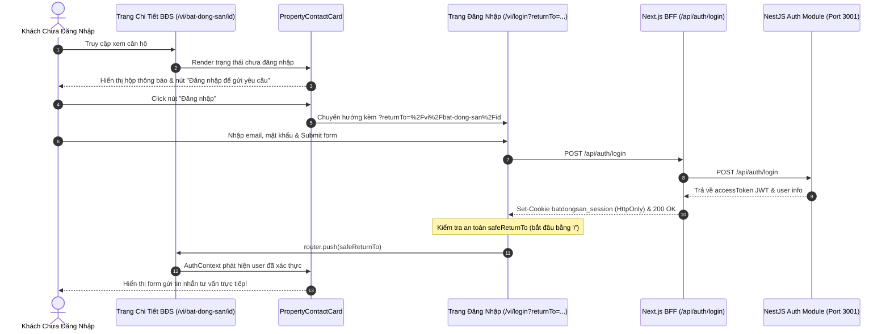
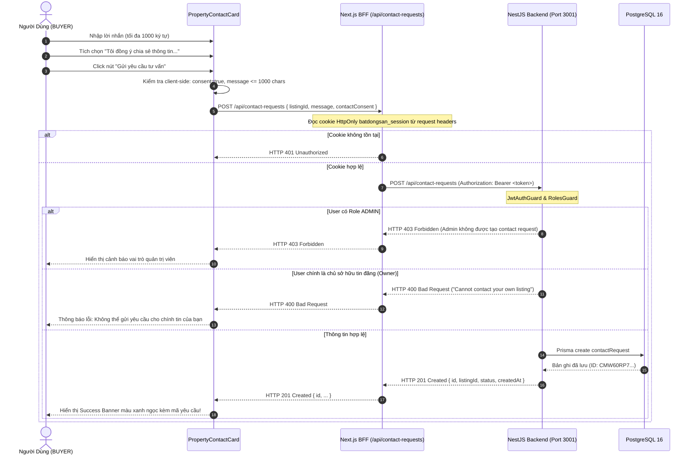

# HƯỚNG DẪN KỸ THUẬT DÀNH CHO LẬP TRÌNH VIÊN: MODULE CHI TIẾT BẤT ĐỘNG SẢN & GỬI YÊU CẦU LIÊN HỆ (PHASE 2E-2C)
## Kiến Trúc Component, Tích Hợp Next.js BFF, Luồng Chuyển Hướng returnTo, Bảo Mật Session HttpOnly & Kiểm Thử Chrome CDP

---

## 1. TỔNG QUAN & MỤC TIÊU THIẾT KẾ

Module Chi Tiết Bất Động Sản & Gửi Yêu Cầu Liên Hệ (Phase 2E-2C) là điểm hội tụ quan trọng trong hành trình khách hàng của nền tảng Batdongsan, kết nối trực tiếp từ Trang chủ (Homepage) và Trang tìm kiếm (Search Results) tới trải nghiệm xem chi tiết và chuyển đổi khách hàng tiềm năng (Lead Conversion).

Trang chi tiết được triển khai trên cấu trúc route động đa ngôn ngữ của Next.js 16 App Router:
- Tiếng Việt: `/[locale]/bat-dong-san/[id]` (Ví dụ: `/vi/bat-dong-san/seed_listing_01`)
- Tiếng Anh: `/[locale]/bat-dong-san/[id]` (Ví dụ: `/en/bat-dong-san/seed_listing_01`)

### 1.1. Mục Tiêu Cốt Lõi
1. **Trải nghiệm thị giác cao cấp theo thiết kế Google Stitch:** Tái hiện trung thực thiết kế Stitch Screen ID `ed439158f49c45a9a33d31e014de8d2a` ("Chi tiết bất động sản (Desktop)", Project ID: `13967597418813716400`) với thư viện ảnh lưới 12 cột, tỷ lệ vàng 65/35, lightbox phóng to toàn màn hình, thanh thông tin nổi bật và thẻ tư vấn dính (Sticky Sidebar).
2. **Trung thực về dữ liệu (Data Truthfulness & Privacy Boundary):**
   - Chỉ hiển thị dữ liệu thực tế được quản lý trong cơ sở dữ liệu PostgreSQL qua NestJS Backend (`GET /api/listings/:id`).
   - Tuyệt đối không tạo dữ liệu giả lập (fabricated) về số phòng ngủ, phòng tắm, hướng nhà hay tình trạng pháp lý khi schema chưa có các trường này.
   - Bảo vệ quyền riêng tư người bán: Không công khai địa chỉ số nhà hay tọa độ GPS chính xác. Chỉ hiển thị địa giới hành chính (Phường/Xã, Quận/Huyện, Tỉnh/Thành phố) và vùng bán kính ước lượng (~500m) kèm lời giải thích minh bạch.
3. **Mô hình BFF (Backend-for-Frontend) an toàn:**
   - Client Component không gọi trực tiếp tới NestJS port 3001 mà tương tác qua BFF Route `/api/contact-requests`.
   - Chuyển tiếp cookie xác thực HttpOnly `batdongsan_session` an toàn từ Server Next.js tới NestJS `POST /api/contact-requests`, không để lộ JWT token cho JavaScript phía trình duyệt.
4. **Hành trình người dùng liền mạch với `returnTo`:**
   - Khách vãng lai (chưa đăng nhập) được hướng dẫn đăng nhập thông qua liên kết chứa tham số an toàn `returnTo`.
   - Sau khi đăng nhập thành công tại `/vi/login`, hệ thống tự động đưa người dùng trở lại đúng trang chi tiết bất động sản đang xem để tiếp tục gửi yêu cầu tư vấn.

---

## 2. KIẾN TRÚC TỔNG THỂ & SƠ ĐỒ LUỒNG DỮ LIỆU

### 2.1. Sơ Đồ Kiến Trúc Hệ Thống (Architecture Flowchart)

```mermaid
flowchart TD
    subgraph ClientBrowser["Trình Duyệt Khách Hàng (Client Browser)"]
        NavSearch["Trang Tìm Kiếm / Trang Chủ"] -->|Click Listing Card| DetailPageURL["URL: /[locale]/bat-dong-san/[id]"]
        DetailPageURL --> NextServer["Next.js 16 Server Component (Page.tsx)"]

        subgraph DetailUI["Giao Diện Chi Tiết Bất Động Sản"]
            Gallery["PropertyGallery (Lưới ảnh 12 cột + Lightbox)"]
            Overview["PropertyOverview (H1, Giá VND, Đơn giá m², Badges)"]
            Description["PropertyDescription (Mô tả chi tiết)"]
            Specs["PropertySpecsTable (Bảng thông số xác thực)"]
            PrivacyNotice["PropertyLocationNotice (Bảo mật vị trí & Bán kính ~500m)"]
            ContactCard["PropertyContactCard (Thẻ tư vấn Sticky Sidebar)"]
        end
    end

    subgraph NextServerContext["Next.js Server (BFF / SSR / Metadata)"]
        NextServer --> LayoutMeta["generateMetadata (Canonical, Hreflang, OpenGraph)"]
        NextServer --> FetchDetail["fetchPublicListingDetail(id)"]
        FetchDetail -->|HTTP GET /api/listings/:id| NestListings["NestJS ListingsController (Port 3001)"]

        ContactCard -->|POST /api/contact-requests| BFFContactRoute["Next.js BFF Handler (/api/contact-requests/route.ts)"]
        BFFContactRoute -->|Extract batdongsan_session Cookie| ForwardReq["Chuyển tiếp HTTP POST kèm Authorization Bearer"]
    end

    subgraph BackendDatabase["NestJS Backend & Cơ Sở Dữ Liệu"]
        NestListings -->|Prisma findFirst status=APPROVED| DB[(PostgreSQL 16 Service)]
        ForwardReq -->|POST /api/contact-requests| NestContact["NestJS ContactRequestsController"]
        NestContact -->|Validate DTO, Consent, Roles, Self-Listing| DB
        DB -->|Tạo bản ghi ContactRequest| NestContact
        NestContact -->|HTTP 201 Created {id, status, ...}| BFFContactRoute
        BFFContactRoute -->|HTTP 201 JSON| ContactCard
    end
```

---

### 2.2. Sơ Đồ Trình Tự: Đăng Nhập & Chuyển Hướng returnTo (Sequence Diagram)



---

### 2.3. Sơ Đồ Trình Tự: Gửi Yêu Cầu Liên Hệ & Xử Lý Nghiệp Vụ (Sequence Diagram)



---

## 3. CẤU TRÚC COMPONENT & PHÂN RÃ GIAO DIỆN

Thư mục `frontend/src/components/detail/` được chia nhỏ theo nguyên tắc đơn nhiệm (Single Responsibility Principle):

```
frontend/src/components/detail/
├── PropertyGallery.tsx        # Thư viện ảnh 12 cột, tỷ lệ 65/35 & Lightbox toàn màn hình
├── PropertyOverview.tsx       # Tiêu đề H1, giá VND, đơn giá m², 4 thông số & nút tương tác
├── PropertyDescription.tsx    # Nội dung mô tả chi tiết bất động sản
├── PropertySpecsTable.tsx     # Bảng đặc tả 2 cột thông số đã qua kiểm duyệt
├── PropertyLocationNotice.tsx # Hộp bảo mật quyền riêng tư & bản đồ bán kính hành chính
└── PropertyContactCard.tsx    # Thẻ tư vấn dính bên phải hỗ trợ 4 trạng thái tương tác
```

### 3.1. `PropertyGallery.tsx`
- **Lưới hiển thị Desktop:** Sử dụng CSS Grid 12 cột. Ảnh chính chiếm 8 cột (`lg:col-span-8`, ~65% chiều rộng), cụm 4 ảnh phụ bên phải chiếm 4 cột (`lg:col-span-4`, ~35% chiều rộng). Ảnh thứ 4 có lớp phủ `+N ảnh` khi tổng số ảnh vượt quá 5.
- **Tính trung thực dữ liệu huy hiệu (Data Truthfulness):** Không hiển thị các huy hiệu chưa có căn cứ trong cơ sở dữ liệu như "Xác thực" hay "Độc quyền" (vì schema Prisma và API backend chưa hỗ trợ trường `isVerified` hay `isExclusive`). Chỉ hiển thị nhãn tin kiểm duyệt chính thức khi tin đạt trạng thái `APPROVED`.
- **Responsive Mobile:** Trên màn hình nhỏ (`< 1024px`), ảnh chính chiếm toàn bộ chiều rộng, góc phải dưới xuất hiện badge `Ảnh 1 / N` có biểu tượng máy ảnh.
- **Accessible Lightbox Modal:**
  - Kích hoạt khi click vào bất kỳ ảnh nào trong thư viện.
  - Khóa cuộn trang `document.body.style.overflow = 'hidden'`.
  - Hỗ trợ đầy đủ phím tắt bàn phím: Phím `Escape` đóng modal, phím mũi tên `ArrowLeft` chuyển ảnh trước, phím `ArrowRight` chuyển ảnh tiếp theo.
  - Phía dưới có thanh cuộn hình thu nhỏ (thumbnail strip) cho phép nhảy tới ảnh bất kỳ.

### 3.2. `PropertyOverview.tsx`
- **Mã tin niêm yết chuẩn hóa:** Sử dụng hàm `formatListingReferenceCode(id)` tạo mã định danh duy nhất và xác định (deterministic). Xử lý trọn vẹn cả ID dạng chuỗi tiền tố (ví dụ: `seed_listing_01` -> `BDS-SEED01`, `seed_listing_02` -> `BDS-SEED02`) lẫn ID dạng UUID chuẩn (ví dụ: `BDS-A79D5963`), loại bỏ nguy cơ trùng lặp mã khi cắt chuỗi.
- **Hiển thị giá chuẩn hóa:**
  - Sử dụng hàm `formatVndPrice` với các quy tắc bản địa: `>= 1 tỷ` hiển thị `tỷ` (VI) hoặc `B VND` (EN), `< 1 tỷ` hiển thị `triệu` (VI) hoặc `M VND` (EN).
  - Đơn giá trên mét vuông: Tính toán chuẩn xác `~ X tr/m²` (VI) hoặc `~ X M VND/m²` (EN).
- **4 Thông số cốt lõi:**
  1. *Diện tích:* Đơn vị `m²`.
  2. *Loại hình:* Căn hộ, Nhà phố, Biệt thự, Đất nền, v.v.
  3. *Địa phương:* Tên Quận/Huyện, Tỉnh/Thành phố.
  4. *Cập nhật:* Ngày cập nhật gần nhất theo định dạng bản địa (`dd/MM/yyyy`).
- **Nút tương tác:**
  - Nút *Lưu tin (Favorite):* Do backend hiện tại chưa cung cấp API endpoint quản lý danh sách yêu thích (`SavedListing`), nút này được thiết kế trung thực ở trạng thái tính năng sắp ra mắt (`disabled`, `aria-disabled="true"`, nhãn `Lưu (Sắp ra mắt)` kèm chú thích tooltip).
  - Nút *Chia sẻ (Share):* Sao chép URL hiện tại vào Clipboard kèm thông báo phản hồi "Đã chép liên kết" trong 2.5 giây.

### 3.3. `PropertyDescription.tsx`
- Tự động tách các đoạn văn bản theo ký tự xuống dòng (`\n\n` hoặc `\n`), loại bỏ khoảng trắng thừa và bọc trong thẻ `<p>` có khoảng cách `leading-relaxed` giúp người dùng đọc tin thoải mái trên mọi kích thước màn hình.

### 3.4. `PropertySpecsTable.tsx`
- Bảng thông số kỹ thuật 2 cột chuẩn hóa, phân tách đường viền mềm mại `#E2E8F0`.
- **Nguyên tắc bảo vệ tính trung thực dữ liệu:**
  - Chỉ render các trường có thực trong database: Loại BĐS, Loại giao dịch, Diện tích, Mức giá, Giá/m², Tỉnh/Thành phố, Quận/Huyện, Phường/Xã, Trạng thái duyệt, Ngày đăng, Ngày cập nhật.
  - Không sinh thêm số phòng ngủ, số nhà tắm, hướng cửa chính, hướng ban công hay tình trạng sổ hồng khi chưa có trong schema backend.

### 3.5. `PropertyLocationNotice.tsx`
- **Hộp thoại bảo vệ quyền riêng tư người bán:** Giải thích lý do địa chỉ chính xác không được hiển thị công khai nhằm phòng tránh tiếp cận trái phép và bảo vệ an toàn thông tin cá nhân.
- **Đồ họa mô phỏng bán kính (Minh họa khu vực):** Khối sandbox hiển thị lưới tọa độ chấm tròn, vòng tròn hiệu ứng phát xung (pulse effect) kèm biểu tượng `location_searching` đại diện cho bán kính hành chính mô phỏng ước tính ~500m (minh họa, không dùng để điều hướng GPS chính xác). Vị trí chính xác sẽ được chuyên viên cung cấp khi đặt lịch xem nhà thực tế.

### 3.6. `PropertyContactCard.tsx`
- Thẻ tư vấn dính bên phải (`sticky top-24`), luôn nổi bật khi người dùng cuộn xem nội dung chi tiết.
- Quản lý đồng bộ 4 trạng thái giao diện:
  1. **Khách vãng lai:** Hiển thị hướng dẫn đăng nhập cùng nút bấm chuyển hướng `/login?returnTo=...` và liên kết tạo tài khoản `/register?returnTo=...`.
  2. **Quản trị viên (ADMIN):** Hiển thị thông báo màu hổ phách cảnh báo tài khoản Admin không được phép gửi yêu cầu tư vấn cho tin đăng.
  3. **Người dùng đã đăng nhập (BUYER / OWNER / AGENT):**
     - Banner hiển thị danh tính: Họ tên, email và nhãn vai trò tương ứng.
     - Ô nhập lời nhắn (textarea) có bộ đếm ký tự thực tế `X/1000`.
     - Ô checkbox cam kết đồng ý chia sẻ thông tin liên lạc (bắt buộc). Nút gửi bị vô hiệu hóa (`disabled`) khi chưa tích chọn.
     - Xử lý trạng thái đang gửi (`isSubmitting`) với biểu tượng xoay (spinner).
  4. **Gửi thành công:** Hiển thị biểu tượng `check_circle`, tiêu đề chúc mừng, thông báo ghi nhận kèm mã yêu cầu và nút "Gửi yêu cầu khác" để reset form.

---

## 4. TÍCH HỢP BACKEND QUA NEXT.JS BFF ROUTE

### 4.1. Handler Route `/api/contact-requests/route.ts` (Đã Gia Cố Bảo Mật)

```typescript
// frontend/src/app/api/contact-requests/route.ts
import { NextResponse } from 'next/server';
import { cookies } from 'next/headers';
import { getBackendBaseUrl } from '@/lib/server-config';

export async function POST(request: Request) {
  try {
    const cookieStore = await cookies();
    const sessionCookie = cookieStore.get('batdongsan_session')?.value;

    if (!sessionCookie) {
      return NextResponse.json(
        { statusCode: 401, message: 'Vui lòng đăng nhập để gửi yêu cầu liên hệ.' },
        { status: 401 },
      );
    }

    let body: unknown;
    try {
      body = await request.json();
    } catch {
      return NextResponse.json(
        { statusCode: 400, message: 'Dữ liệu yêu cầu không hợp lệ (JSON malformed).' },
        { status: 400 },
      );
    }

    if (!body || typeof body !== 'object' || Array.isArray(body)) {
      return NextResponse.json(
        { statusCode: 400, message: 'Payload yêu cầu liên hệ phải là một đối tượng JSON.' },
        { status: 400 },
      );
    }

    const { listingId, message, contactConsent } = body as Record<string, unknown>;

    if (!listingId || typeof listingId !== 'string' || listingId.trim() === '') {
      return NextResponse.json(
        { statusCode: 400, message: 'Mã bất động sản (listingId) là bắt buộc.' },
        { status: 400 },
      );
    }

    if (contactConsent !== true) {
      return NextResponse.json(
        { statusCode: 400, message: 'Bạn phải đồng ý chia sẻ thông tin liên lạc để tiếp tục.' },
        { status: 400 },
      );
    }

    if (message !== undefined && message !== null && typeof message !== 'string') {
      return NextResponse.json(
        { statusCode: 400, message: 'Nội dung lời nhắn phải là chuỗi ký tự.' },
        { status: 400 },
      );
    }

    const backendUrl = getBackendBaseUrl();
    const backendRes = await fetch(`${backendUrl}/api/contact-requests`, {
      method: 'POST',
      headers: {
        'Content-Type': 'application/json',
        Authorization: `Bearer ${sessionCookie}`,
      },
      body: JSON.stringify({
        listingId: listingId.trim(),
        message: typeof message === 'string' ? message : undefined,
        contactConsent: true,
      }),
    });

    const data = await backendRes.json();
    return NextResponse.json(data, { status: backendRes.status });
  } catch (error: unknown) {
    // Luôn ghi log lỗi chi tiết phía server nhưng che giấu chuỗi kết nối / exception nhạy cảm phía client
    console.error('[ContactRequestsBFF] Error:', error);
    return NextResponse.json(
      { statusCode: 500, message: 'Internal Server Error' },
      { status: 500 },
    );
  }
}
```

### 4.2. Bảo Mật Luồng returnTo Chống Open Redirect Với Bộ Lọc Chuyên Dụng
Tại `frontend/src/lib/navigation.ts`, module `sanitizeReturnTo` và `isValidReturnTo` được xây dựng để thẩm định triệt để tham số chuyển hướng:
- Ngăn chặn triệt để các URL tuyệt đối mang scheme ngoài (`http:`, `https:`, `javascript:`, `data:`, `vbscript:`).
- Ngăn chặn protocol-relative URL bắt đầu bằng dấu gạch chéo kép `//`.
- Ngăn chặn ký tự gạch chéo ngược `\` (backslash), bao gồm cả các biến thể đã URL-encode như `%5c` hoặc `%5C`, nhằm triệt tiêu thủ thuật lách trình duyệt biến đường dẫn nội bộ thành chuyển hướng ngoại vi (`/\evil.com` hoặc `/%5cevil.com`).
- Ngăn chặn ký tự điều khiển ASCII không an toàn (control characters `\x00` - `\x1F`).
- Sử dụng dummy origin an toàn `http://localhost.internal` để parse và bảo toàn chính xác pathname, query params và hash nội bộ.

```typescript
// frontend/src/lib/navigation.ts
export function isValidReturnTo(target: unknown): boolean {
  if (typeof target !== 'string') return false;
  const trimmed = target.trim();
  if (!trimmed || !trimmed.startsWith('/')) return false;
  if (trimmed.startsWith('//')) return false;
  if (trimmed.includes('\\') || /%5c/i.test(trimmed)) return false;
  if (/[\x00-\x1F\x7F]/.test(trimmed)) return false;

  try {
    const parsed = new URL(trimmed, 'http://localhost.internal');
    return parsed.origin === 'http://localhost.internal';
  } catch {
    return false;
  }
}

export function sanitizeReturnTo(target: unknown, fallback: string = '/'): string {
  if (!isValidReturnTo(target)) return fallback;
  const trimmed = (target as string).trim();
  try {
    const parsed = new URL(trimmed, 'http://localhost.internal');
    return `${parsed.pathname}${parsed.search}${parsed.hash}`;
  } catch {
    return fallback;
  }
}
```

Khi áp dụng tại `LoginPage` (`frontend/src/app/[locale]/login/page.tsx`) và `RegisterPage` (`frontend/src/app/[locale]/register/page.tsx`):
```typescript
const searchParams = useSearchParams();
const rawReturnTo = searchParams?.get('returnTo');
const safeReturnTo = sanitizeReturnTo(rawReturnTo, '');

// Sau khi xác thực thành công:
if (safeReturnTo) {
  router.push(safeReturnTo);
} else {
  router.push(localizeHref('/'));
}
```

---

## 5. BỘ TỪ ĐIỂN ĐA NGÔN NGỮ (I18N METADATA & MESSAGES)

Dữ liệu ngôn ngữ cho trang chi tiết được quy hoạch tại namespace `PropertyDetail` trong cả hai tệp:
- `frontend/messages/vi.json`
- `frontend/messages/en.json`

Metadata SEO được khởi tạo qua hàm `buildLocalizedListingDetailMetadata` tại `frontend/src/i18n/metadata.ts`:
- **Canonical URL:** Tự động tạo URL tuyệt đối trỏ về phiên bản ngôn ngữ hiện hành.
- **Hreflang Alternates:** Cung cấp đầy đủ liên kết `vi`, `en`, và `x-default` (mặc định về Tiếng Việt).
- **OpenGraph:** Thiết lập thẻ `og:title`, `og:description`, `og:url`, `og:type = article` và ảnh đại diện bất động sản phục vụ chia sẻ lên Zalo, Facebook, LinkedIn.

---

## 6. HỆ THỐNG KIỂM THỬ TOÀN DIỆN & TRÌNH DUYỆT CHROME CDP

Toàn bộ giải pháp được bảo chứng qua 2 tầng kiểm thử nghiêm ngặt:

### 6.1. Unit & Integration Test Suite (Vitest)
Hệ thống kiểm thử tự động đạt tỷ lệ pass tuyệt đối **100%**:
- **Frontend Vitest Suite:** **153/153 tests pass** trên 15 tệp kiểm thử.
  - `frontend/src/__tests__/detail.test.tsx` (**23 tests**):
    - Khử nhiễm và chuẩn hóa dữ liệu tin đăng, sắp xếp mảng ảnh theo thứ tự `order`.
    - Thẩm định trả về `null` khi backend trả 404 hoặc trạng thái khác `APPROVED`.
    - Khởi tạo đầy đủ thư viện ảnh tỷ lệ 65/35, mở lightbox toàn màn hình qua chuột và bàn phím (`Space`, `Enter`), duyệt ảnh trước/sau và đóng bằng `Escape`.
    - Trạng thái fallback khi không có hình ảnh hoặc mô tả rỗng/chỉ chứa khoảng trắng (hỗ trợ cả Tiếng Việt và Tiếng Anh).
    - Hiển thị giá VND, đơn giá m² và 4 thông số cốt lõi mà không bịa đặt thông số kỹ thuật.
    - Xử lý sao chép liên kết clipboard kèm thông báo trực quan.
    - Hiển thị thông báo bảo vệ vị trí địa lý vùng bán kính ~500m mà không lộ số nhà/tọa độ riêng tư.
    - Hiển thị trạng thái khách vãng lai kèm liên kết `returnTo`, trạng thái vô hiệu hóa đối với Admin, và cho phép Buyer gửi yêu cầu thành công kèm cam kết chia sẻ thông tin.
    - Xử lý từ chối khi chủ nhà tự gửi yêu cầu cho chính tin đăng của mình (HTTP 400).
    - Tạo dynamic SEO metadata (canonical URL, alternates hreflang, OpenGraph).
    - Render giao diện 404 chuyên dụng `not-found.tsx` và Error Boundary 500 `error.tsx` kèm nút thử lại (`reset()`).
  - `frontend/src/__tests__/bff-contact-requests.test.ts` (**10 tests**):
    - Kiểm tra từ chối khi thiếu session cookie (HTTP 401).
    - Kiểm tra từ chối khi payload không phải đối tượng JSON hoặc `listingId` rỗng/khoảng trắng (HTTP 400).
    - Kiểm tra từ chối khi thiếu `contactConsent: true` hoặc `message` không phải kiểu chuỗi (HTTP 400).
    - Kiểm tra chuyển tiếp Bearer token và xử lý đúng mã lỗi từ NestJS (HTTP 201, 403, 400).
    - Đảm bảo khi backend phát sinh lỗi hệ thống 500, BFF che giấu toàn bộ exception stack/chuỗi kết nối nội bộ và trả về `Internal Server Error` an toàn.
  - `frontend/src/__tests__/navigation.test.ts` (**13 tests**):
    - Kiểm thử chuyên sâu 13 tình huống thẩm định `returnTo`, triệt tiêu toàn bộ rủi ro Open Redirect, URL scheme ngoài, protocol-relative paths (`//`), backslashes (`\`, `%5c`, `%5C`), và ký tự điều khiển.
  - `frontend/src/__tests__/LoginPage.test.tsx` (**8 tests**) & `RegisterPage.test.tsx` (**8 tests**):
    - Đảm bảo bảo toàn form state qua đa ngôn ngữ và chuyển hướng an toàn theo `safeReturnTo`.
- **Backend Test Suite:** **132/132 tests pass** (và 128 tests trong unit suite), bao quát phân quyền vai trò, lifecycle tin đăng và tạo/quản lý yêu cầu liên hệ.
- **Linters:** Frontend ESLint (0 errors, 0 warnings), Backend Oxlint (0 errors, 0 warnings).
- **Production Builds:** Cả Frontend Next.js Turbopack và Backend NestJS đều build thành công tuyệt đối 0 lỗi.

### 6.2. Kiểm Thử Trình Duyệt Thực Tế Bằng Chrome CDP
Kịch bản tự động `scratch/browser-verify-detail.mjs` chạy trực tiếp trên Google Chrome thông qua Chrome DevTools Protocol:

| Kịch Bản | Mục Tiêu Kiểm Thử | Mã HTTP | Tệp Ảnh Minh Chứng | Kết Quả |
| :--- | :--- | :---: | :--- | :---: |
| **Kịch bản 1** | Chi tiết Desktop Tiếng Việt (`/vi/bat-dong-san/seed_listing_01`) | `200 OK` | `phase2e2c-detail/01-vi-detail-desktop.png` | **100% PASS** |
| **Kịch bản 2** | Chi tiết Desktop Tiếng Anh (`/en/bat-dong-san/seed_listing_01`) | `200 OK` | `phase2e2c-detail/02-en-detail-desktop.png` | **100% PASS** |
| **Kịch bản 3** | Mở Lightbox Modal, đếm ảnh `1 / 2`, đóng bằng phím `Escape` | `200 OK` | `phase2e2c-detail/03-vi-lightbox-modal-desktop.png` | **100% PASS** |
| **Kịch bản 4** | Khách vãng lai kiểm tra liên kết đăng nhập kèm `returnTo` | `200 OK` | `phase2e2c-detail/04-vi-login-return-to-desktop.png` | **100% PASS** |
| **Kịch bản 5** | Đăng nhập tài khoản Buyer, tự động chuyển hướng về trang chi tiết | `200 OK` | `phase2e2c-detail/05-vi-detail-authenticated-desktop.png` | **100% PASS** |
| **Kịch bản 6** | Gửi form yêu cầu tư vấn kèm cam kết, hiển thị mã yêu cầu động từ DB | `200 OK` | `phase2e2c-detail/06-vi-contact-request-success-desktop.png` | **100% PASS** |
| **Kịch bản 7** | Giao diện Không tìm thấy (404) khi ID không tồn tại hoặc chưa duyệt | `404 Not Found` | `phase2e2c-detail/07-vi-detail-not-found-desktop.png` | **100% PASS** |
| **Kịch bản 8** | Giao diện hiển thị Responsive Mobile trên khung hình 390x844 | `200 OK` | `phase2e2c-detail/08-vi-detail-mobile.png` | **100% PASS** |

> *Ghi chú về mã yêu cầu liên hệ:* Mã yêu cầu hiển thị trong thông báo thành công (ví dụ: `#CMW80VYC`, `#CMW60RP7`) được sinh ngẫu nhiên định danh bởi backend và lưu trữ thực tế trong bảng `ContactRequest` của PostgreSQL. Bài kiểm thử trình duyệt thẩm định sự tồn tại và tính hợp lệ động của mã định danh này thay vì gán cứng một giá trị tĩnh.

---

## 7. QUY TRÌNH BẢO TRÌ & GỠ LỖI DÀNH CHO KỸ SƯ MỚI

1. **Khởi động môi trường cục bộ:**
   - Đảm bảo service `postgresql-x64-16` đang chạy trên cổng 5432.
   - Khởi động backend NestJS: `npm --prefix backend run start:dev` (hoặc `npm --prefix backend run start:prod`).
   - Khởi động frontend Next.js: `npm --prefix frontend run dev` (hoặc `build` + `start`).
2. **Kiểm tra route chi tiết:**
   - Truy cập `http://localhost:3000/vi/bat-dong-san/seed_listing_01`.
   - Đăng nhập thử với tài khoản mẫu phát triển cục bộ: `buyer@example.test` / `DemoPassword123!`.
   > *Lưu ý an toàn:* `buyer@example.test` là tài khoản dữ liệu mẫu nội bộ được khởi tạo từ tệp seed (`database/prisma/seed.ts`), hoàn toàn độc lập và không bao giờ được cấu hình hay cấp quyền trên môi trường production.
3. **Cơ chế xử lý lỗi HTTP & Not Found:**
   - Khi một tin đăng không tồn tại hoặc có trạng thái khác `APPROVED`, Server Component sẽ gọi `notFound()`, Next.js sẽ chuyển quyền render cho `frontend/src/app/[locale]/bat-dong-san/[id]/not-found.tsx` và trả về mã HTTP 404 thực thụ cho trình duyệt và các bộ máy tìm kiếm (SEO).
   - Khi xảy ra lỗi mạng hoặc backend ngoại tuyến (5xx), Server Component truyền lỗi ra Error Boundary `frontend/src/app/[locale]/bat-dong-san/[id]/error.tsx` để hiển thị nút "Thử lại" mà không nhận nhầm thành lỗi 404.
4. **Lưu ý tương thích Next.js 16 App Router:**
   - Trang chi tiết và các layout liên quan có sử dụng Client Hooks (`useSearchParams`) bắt buộc phải bọc trong `<Suspense fallback={null}>` và khai báo `export const instant = false;` để hỗ trợ cơ chế render streaming ổn định.
   - Không khai báo đồng thời `export const dynamic = 'force-dynamic'` khi `next.config.ts` đang kích hoạt `cacheComponents`.
