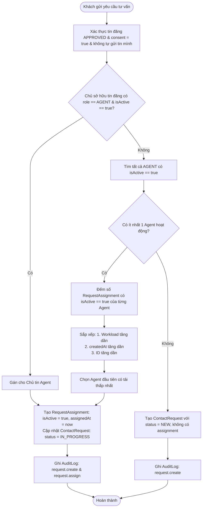

# BÁO CÁO TIẾN ĐỘ TRIỂN KHAI BACKEND PHASE 2D-2: CONTACT REQUESTS & AGENT ASSIGNMENTS

**Dự án:** Batdongsan (Website tìm kiếm và quản lý bất động sản tích hợp MLS nội bộ)\
**Nhánh:** `feat/phase2d2-contact-requests`\
**Base Commit:** `0a355a7`\
**Thời điểm thực hiện:** 31/10/2026\
**Môi trường:** NestJS 12, TypeScript, PostgreSQL 16 Native Windows (port 5432), Prisma 7.10.1, Vitest, Supertest\

---

## 1. Tóm tắt kết quả triển khai (Implementation Summary)

Giai đoạn Phase 2D-2 hoàn thành việc xây dựng toàn bộ mô-đun **Contact Requests & Agent Assignments Backend** trên nền tảng cơ sở dữ liệu hiện có mà **không thay đổi Prisma schema hoặc tạo migration mới**.

Các mục tiêu nghiệp vụ và kỹ thuật đã hoàn thành toàn diện:
1. **Khởi tạo yêu cầu tư vấn an toàn:** Cho phép các vai trò `BUYER`, `OWNER`, `AGENT` gửi yêu cầu tư vấn cho tin đăng ở trạng thái `APPROVED`; cấm `ADMIN` tạo yêu cầu; chống tự gửi yêu cầu cho tin chính mình sở hữu (`listing.ownerId !== caller.id`); bắt buộc đồng ý chia sẻ thông tin liên hệ (`contactConsent: true`).
2. **Thuật toán phân công môi giới tự động (Deterministic MVP Policy):**
   - **Ưu tiên 1:** Nếu chủ tin là môi giới đang hoạt động (`role === AGENT` và `isActive === true`), ưu tiên phân công cho môi giới này.
   - **Ưu tiên 2:** Chọn môi giới đang hoạt động có khối lượng công việc hoạt động (`isActive === true` trong `RequestAssignment`) thấp nhất. Giải quyết hòa xác định bằng `createdAt` tăng dần, sau đó đến `id` tăng dần.
   - **Cơ chế dự phòng (Fallback):** Nếu hệ thống không có môi giới nào đủ điều kiện, yêu cầu được tạo ở trạng thái `NEW` và không có phân công hoạt động, hiển thị cho `ADMIN` phân công thủ công.
3. **Chính sách bảo mật và công bố thông tin (Caller-specific Response Allowlists):**
   - Không để lộ `passwordHash` hoặc thông tin nhạy cảm trong bất kỳ API response nào.
   - **Người mua:** Xem các yêu cầu của chính mình và thông tin tóm tắt của môi giới phụ trách.
   - **Môi giới phụ trách:** Chỉ xem được yêu cầu khi đang có phân công hoạt động (`isActive === true`). Xem được họ tên; chỉ xem email/sđt khi `contactConsent === true`. Khi bị điều phối lại, mất quyền truy cập ngay lập tức (`403 Forbidden`).
   - **Chủ sở hữu tin đăng:** Chỉ nhận siêu dữ liệu rút gọn (metadata-only allowlist). Tuyệt đối không nhận họ tên, email, sđt, ID người mua, nội dung tin nhắn hoặc lịch sử môi giới.
   - **Quản trị viên (ADMIN):** Xem toàn bộ danh sách, thông tin người mua và lịch sử phân công.
4. **Máy trạng thái & Quy trình Reopen của Quản trị viên:**
   - Trạng thái: `NEW`, `IN_PROGRESS`, `COMPLETED`, `REJECTED`.
   - Các trạng thái `COMPLETED` và `REJECTED` là terminal states, môi giới không thể tự ý thay đổi.
   - Endpoint `POST /api/contact-requests/:id/reopen` chỉ dành cho `ADMIN` với lý do (`reason`) bắt buộc.
5. **Giao dịch và Toàn vẹn đồng thời (Concurrency & Transactions):**
   - Các thao tác tạo yêu cầu, phân công, điều phối lại, đổi trạng thái và mở lại đều được thực thi trong một Prisma Transaction duy nhất kèm theo ghi nhận `AuditLog`.
   - Tận dụng chỉ mục một phần PostgreSQL `request_assignments_contactRequestId_key` với điều kiện `WHERE ("isActive" = true)` để loại bỏ nguy cơ race condition có 2 môi giới hoạt động cùng lúc. Bắt lỗi `P2002` và chuyển thành `409 Conflict`.

---

## 2. Danh sách tệp đã tạo và chỉnh sửa (Files Created/Modified)

### Tệp tạo mới:
- `backend/src/contact-requests/contact-requests.module.ts`: Khai báo module và liên kết controller, service, PrismaService.
- `backend/src/contact-requests/contact-requests.controller.ts`: 10 REST API endpoints bảo vệ bằng `JwtAuthGuard`, `RolesGuard`, `@Roles()`, `@CurrentUser()`.
- `backend/src/contact-requests/contact-requests.service.ts`: Toàn bộ logic nghiệp vụ, thuật toán phân công, allowlists bảo mật, máy trạng thái, giao dịch và audit logging.
- `backend/src/contact-requests/contact-requests.spec.ts`: Bộ 32 unit tests mocked Prisma toàn diện.
- `backend/src/contact-requests/dto/create-contact-request.dto.ts`: DTO tạo yêu cầu với validation `listingId`, `message` (tối đa 1000 ký tự), `contactConsent` (boolean, bắt buộc `true`).
- `backend/src/contact-requests/dto/update-request-status.dto.ts`: DTO cập nhật trạng thái với validation enum `ContactRequestStatus`, `note` (tối đa 500 ký tự).
- `backend/src/contact-requests/dto/assign-agent.dto.ts`: DTO phân công lần đầu với validation `agentId`, `reason` (tối đa 500 ký tự).
- `backend/src/contact-requests/dto/reassign-agent.dto.ts`: DTO điều phối lại với validation `agentId`, `reason` (tối đa 500 ký tự).
- `backend/src/contact-requests/dto/reopen-contact-request.dto.ts`: DTO mở lại với validation `reason` bắt buộc, trimmed, không rỗng (tối đa 500 ký tự).
- `backend/src/contact-requests/dto/query-contact-requests.dto.ts`: DTO truy vấn danh sách (phân trang, lọc theo status, listingId, agentId, unassigned).
- `backend/test/contact-requests.e2e-spec.ts`: Bộ 26 integration tests trên PostgreSQL 16 thật kiểm thử toàn bộ endpoint và race condition.
- `docs/reports/PHASE2D2_CONTACT_REQUESTS_BACKEND_PROGRESS_2026-10-31.md`: Báo cáo tiến độ chi tiết.

### Tệp chỉnh sửa:
- `backend/src/app.module.ts`: Đăng ký `ContactRequestsModule`.
- `docs/01-requirements.md`: Bổ sung chi tiết FR-08, FR-09, FR-10 và các ghi chú về hoãn phân công theo khu vực/gói thuê bao ngoài MVP.

---

## 3. Danh mục API Endpoints (API Endpoint Summary)

| STT | Phương thức | Đường dẫn URI | Vai trò được phép | Mô tả tóm tắt |
|:---:|:---:|:---|:---|:---|
| 1 | `POST` | `/api/contact-requests` | `BUYER`, `OWNER`, `AGENT` | Tạo yêu cầu tư vấn trên tin `APPROVED`, tự động phân công môi giới |
| 2 | `GET` | `/api/contact-requests/my-requests` | `BUYER`, `OWNER`, `AGENT` (Creator) | Người mua xem danh sách yêu cầu của chính mình |
| 3 | `GET` | `/api/contact-requests/assigned` | `AGENT` (Active) | Môi giới xem danh sách yêu cầu đang được phân công hoạt động |
| 4 | `GET` | `/api/contact-requests/for-owned-listings` | `OWNER`, `AGENT` (Owner) | Chủ tin xem danh sách yêu cầu liên quan đến tin đăng của mình (Metadata-only) |
| 5 | `GET` | `/api/contact-requests` | `ADMIN` | Quản trị viên xem và lọc toàn bộ danh sách yêu cầu |
| 6 | `GET` | `/api/contact-requests/:id` | Creator, Active Agent, Owner, ADMIN | Xem chi tiết yêu cầu theo allowlist phân quyền tương ứng |
| 7 | `PATCH` | `/api/contact-requests/:id/status` | Active Agent, `ADMIN` | Cập nhật trạng thái yêu cầu theo máy trạng thái hợp lệ |
| 8 | `POST` | `/api/contact-requests/:id/assign` | `ADMIN` | Phân công môi giới lần đầu cho yêu cầu chưa có phân công hoạt động |
| 9 | `POST` | `/api/contact-requests/:id/reassign` | `ADMIN` | Điều phối lại môi giới (giải phóng phân công cũ, tạo phân công mới) |
| 10 | `POST` | `/api/contact-requests/:id/reopen` | `ADMIN` | Mở lại yêu cầu ở trạng thái kết thúc kèm lý do bắt buộc |
| 11 | `GET` | `/api/contact-requests/:id/assignments` | Active Agent, `ADMIN` | Xem lịch sử phân công theo trình tự thời gian |

---

## 4. Thiết kế phân quyền và chính sách bảo mật (Authorization & Privacy Design)

### Ma trận công bố thông tin (Field-Level Disclosure Matrix):

| Trường dữ liệu | Người mua tạo yêu cầu | Môi giới phụ trách (`contactConsent: true`) | Môi giới phụ trách (`contactConsent: false`) | Chủ sở hữu tin đăng (`listing.ownerId`) | Quản trị viên (`ADMIN`) |
|:---|:---:|:---:|:---:|:---:|:---:|
| `id`, `listingId`, `status`, `createdAt`, `updatedAt` | Có | Có | Có | Có | Có |
| `listing` summary (title, price, area, address) | Có | Có | Có | Có | Có |
| `buyer.id`, `buyer.fullName` | Có | Có | Có | **KHÔNG** | Có |
| `buyer.email`, `buyer.phone` | Có | **Có** | **KHÔNG** | **KHÔNG** | Có |
| `message` (nội dung tư vấn) | Có | Có | Có | **KHÔNG** | Có |
| `assignedAgent` summary | Có | Có | Có | **KHÔNG** | Có |
| `assignments` (lịch sử phân công) | **KHÔNG** | Có | Có | **KHÔNG** | Có |
| `passwordHash` | **KHÔNG** | **KHÔNG** | **KHÔNG** | **KHÔNG** | **KHÔNG** |

### Thu hồi quyền ngay lập tức (Immediate Access Revocation):
- Môi giới chỉ được truy cập chi tiết và cập nhật trạng thái khi bản ghi `RequestAssignment` tương ứng có `agentId === caller.id` và `isActive === true`.
- Khi `ADMIN` thực hiện điều phối lại qua `POST /reassign`, phân công cũ chuyển thành `isActive = false`, khiến môi giới cũ lập tức nhận `403 Forbidden` khi cố truy cập lại.

---

## 5. Thuật toán phân công tự động (Automatic Assignment Behavior)



---

## 6. Xử lý giao dịch và giải quyết xung đột đồng thời (Concurrency Handling)

1. **Prisma Transaction:**
   - Mọi thao tác ghi nhiều bảng (ContactRequest + RequestAssignment + AuditLog) đều được thực hiện qua `prisma.$transaction(async (tx) => { ... })`.
2. **PostgreSQL Partial Unique Index:**
   - Chỉ mục: `CREATE UNIQUE INDEX "request_assignments_contactRequestId_key" ON "request_assignments"("contactRequestId") WHERE ("isActive" = true);`
   - Đảm bảo cơ sở dữ liệu ở tầng vật lý không bao giờ tồn tại 2 bản ghi `RequestAssignment` cùng `contactRequestId` và cùng có `isActive = true`.
3. **Bắt lỗi xung đột đồng thời:**
   - Khi có 2 yêu cầu phân công hoặc điều phối lại chạy đồng thời, thao tác thua cuộc sẽ gặp vi phạm ràng buộc duy nhất (Prisma Error code `P2002`). Service bắt chính xác mã lỗi `P2002` trên target `request_assignments_contactRequestId_key` và chuyển đổi thành `409 ConflictException` với thông báo rõ ràng cho client.

---

## 7. Kết quả kiểm thử (Verification Results)

### 7.1. Unit Tests (`npm test`):
```
 RUN  v4.1.12 D:/Batdongsan/backend

 ✓ src/mls/mls.spec.ts (39 tests) 61ms
 ✓ src/contact-requests/contact-requests.spec.ts (32 tests) 64ms
 ✓ src/app.controller.spec.ts (1 test) 1289ms
 ✓ src/listings/listings.spec.ts (28 tests) 447ms
 ✓ src/auth/auth.spec.ts (16 tests) 1310ms

 Test Files  5 passed (5)
      Tests  116 passed (116)
   Duration  7.50s
```
- **32/32 unit tests cho Contact Requests đạt 100%:** Bao gồm kiểm thử tạo yêu cầu (vai trò, tự gửi tin, listing trạng thái, consent), phân công tự động (ưu tiên chủ tin agent, chọn tải thấp nhất, tie-break, fallback), allowlists bảo mật (buyer, agent có/không consent, owner metadata-only, admin, không lộ passwordHash), máy trạng thái (chuyển đổi hợp lệ, chặn terminal, admin reopen kèm reason), phân công & điều phối lại (xung đột, thu hồi quyền môi giới cũ, kiểm tra agent hợp lệ).
- Tổng toàn bộ backend có **116/116 unit tests vượt qua**.

### 7.2. Real PostgreSQL E2E Tests (`npm run test:e2e`):
```
 RUN  v4.1.12 D:/Batdongsan/backend

 ✓ test/listings.e2e-spec.ts (15 tests) 3464ms
 ✓ test/contact-requests.e2e-spec.ts (26 tests) 1231ms
 ✓ test/mls.e2e-spec.ts (32 tests) 2113ms
 ✓ test/app.e2e-spec.ts (1 test) 450ms

 Test Files  4 passed (4)
      Tests  74 passed (74)
   Duration  16.66s
```
- **26/26 E2E tests trên PostgreSQL 16 thật đạt 100%:**
  1. POST tạo request trên tin APPROVED -> 201, IN_PROGRESS, auto-assigned.
  2. POST tạo request trên tin DRAFT -> 400 Bad Request.
  3. POST tạo request trên tin do chính mình sở hữu -> 400 Bad Request.
  4. POST tạo request với contactConsent = false -> 400 Bad Request.
  5. POST tạo request khi chủ tin là Agent -> tự động gán cho chủ tin Agent.
  6. POST tạo request khi không có Agent hoạt động -> 201, NEW, unassigned.
  7. GET /my-requests -> người mua xem đúng danh sách yêu cầu của mình.
  8. GET /assigned -> Agent xem các yêu cầu được gán, kiểm tra allowlist email/phone theo consent.
  9. GET /for-owned-listings -> Owner xem metadata-only, tuyệt đối không thấy thông tin Buyer hoặc Message.
  10. GET /api/contact-requests -> ADMIN xem toàn bộ danh sách và lọc.
  11. GET /:id -> Phân quyền truy cập chi tiết (Creator, Active Agent, Admin, Owner metadata-only; người không liên quan nhận 403 Forbidden).
  12. PATCH /:id/status -> Active Agent cập nhật trạng thái hợp lệ (IN_PROGRESS -> COMPLETED).
  13. PATCH /:id/status -> Chặn thay đổi trạng thái khi đã kết thúc (400 Bad Request).
  14. POST /:id/assign -> ADMIN phân công lần đầu.
  15. POST /:id/assign -> Xung đột khi đã có phân công hoạt động -> 409 Conflict.
  16. POST /:id/reassign -> ADMIN điều phối lại thành công.
  17. Quyền truy cập bị thu hồi tức thì: Agent cũ nhận 403 Forbidden sau khi bị reassign.
  18. GET /:id/assignments -> Lịch sử phân công (chỉ ADMIN và Active Agent được xem).
  19. POST /:id/reopen -> Mở lại request terminal thành công kèm lý do.
  20. POST /:id/reopen -> Từ chối khi thiếu lý do mở lại.
  21. Kiểm tra race condition đồng thời: Hai request reassign cạnh tranh song song trên cùng một Contact Request không bao giờ để lại 2 phân công hoạt động trong PostgreSQL (chỉ mục một phần bảo vệ tuyệt đối).
- Tổng toàn bộ backend có **74/74 E2E integration tests vượt qua**.

### 7.3. Dấu vân tay cơ sở dữ liệu (Database Fingerprint Comparison):
Trước và sau khi chạy bộ kiểm thử E2E:
```json
{
  "listings": 10,
  "shares": 3,
  "contactRequests": 2,
  "requestAssignments": 3,
  "auditLogs": 0,
  "users": 5
}
```
Dấu vân tay trước và sau kiểm thử **hoàn toàn trùng khớp** (`baseline === after`). Tất cả các bản ghi khởi tạo phục vụ kiểm thử được thu dọn sạch sẽ theo đúng thứ tự khóa ngoại. Dữ liệu seed gốc không bị thay đổi.

### 7.4. Build và Lint:
- `npm run build`: Hoàn tất không có lỗi TypeScript (`nest build` exit code 0).
- `npm run lint`: Hoàn tất không có lỗi hoặc cảnh báo (`oxlint src/ test/` -> `Found 0 warnings and 0 errors`).
- `git diff --check`: Không có lỗi định dạng hay khoảng trắng thừa.

---

## 8. Hạn chế đã biết và các hạng mục hoãn lại sau MVP (Limitations & Deferred Items)

1. **Phân công môi giới theo khu vực địa lý (Agent Service Area Matching):** Bảng `User` hiện tại chưa có trường dữ liệu lưu trữ khu vực phục vụ (quận/huyện, tỉnh/thành) của Agent. Đã ghi nhận trong yêu cầu để triển khai khi hoàn thiện hồ sơ môi giới nâng cao.
2. **Phân công theo thứ hạng gói thuê bao (Agent Subscription Tier Matching):** Hệ thống phân hạng môi giới theo gói dịch vụ (Standard, Pro, VIP) là tính năng thương mại sau MVP.
3. **Kênh trao đổi trực tiếp môi giới - chủ tin (Broker-to-Owner Communication):** Yêu cầu tư vấn hiện tại chỉ phục vụ kết nối người mua với môi giới phụ trách; luồng nhắn tin hoặc trao đổi trực tiếp giữa môi giới và chủ nhà được hoãn lại theo quyết định kiến trúc trước đó.
4. **Thông báo thời gian thực (Push / Email Notifications):** Hiện tại hệ thống ghi nhận trạng thái và AuditLog; việc tích hợp gửi email/SMS thông báo khi có yêu cầu mới sẽ được triển khai ở pha tích hợp dịch vụ bên ngoài.

---

## 9. Đợt khắc phục sau rà soát mã nguồn (Post-Implementation Code Review Remediation)

### 9.1. Chi tiết các lỗi đã khắc phục (Bugs & Remediation Items)

1. **Thực thi đầy đủ ma trận chuyển đổi trạng thái (Status Transition Matrix):**
   - **Lỗi trước đó:** Kiểm tra điều kiện lỏng lẻo cho phép trạng thái đảo ngược bất hợp lệ `IN_PROGRESS -> NEW`, `NEW -> IN_PROGRESS` qua PATCH status trực tiếp bỏ qua quy trình phân công, hoặc cập nhật trùng trạng thái hiện tại.
   - **Khắc phục:** Triển khai ma trận chuyển đổi tường minh trong `updateStatus()`:
     - `NEW -> REJECTED`: Chỉ ADMIN được phép.
     - `NEW -> IN_PROGRESS`: Bị cấm qua `PATCH /:id/status` (bắt buộc thông qua endpoint phân công `/assign`).
     - `NEW -> COMPLETED`: Bị cấm (`400 Bad Request`).
     - `IN_PROGRESS -> COMPLETED`: Môi giới đang phụ trách hoặc ADMIN.
     - `IN_PROGRESS -> REJECTED`: Môi giới đang phụ trách hoặc ADMIN.
     - `IN_PROGRESS -> NEW`: Bị cấm tuyệt đối (`400 Bad Request`).
     - Trùng trạng thái (`NEW -> NEW`, `IN_PROGRESS -> IN_PROGRESS`): Từ chối (`400 Bad Request`).
     - Trạng thái kết thúc (`COMPLETED`, `REJECTED`): Từ chối mọi yêu cầu qua PATCH (`400 Bad Request`), bắt buộc ADMIN dùng `/reopen`.

2. **Đưa toàn bộ kiểm tra nghiệp vụ trọng yếu vào trong giao dịch (Transaction Encapsulation & Concurrency):**
   - **Lỗi trước đó:** Một số dữ liệu đọc (như kiểm tra trạng thái tin đăng `APPROVED`, quyền sở hữu tin đăng, vai trò và trạng thái hoạt động của Agent) được thực hiện bên ngoài giao dịch, có nguy cơ đọc dữ liệu cũ (stale read) khi có thao tác đồng thời.
   - **Khắc phục:** Đưa 100% các bước đọc xác thực vào bên trong `prisma.$transaction`:
     - `createRequest()`: Đọc lại tin đăng trong transaction, kiểm tra tồn tại, trạng thái `APPROVED`, chống self-request, kiểm tra trạng thái hoạt động của chủ tin Agent, thuật toán phân công tự động, tạo bản ghi request, assignment và ghi `AuditLog` nguyên tử.
     - `assignAgent()`: Kiểm tra trạng thái không phải terminal, xác thực chưa có active assignment (nếu có ném `409 Conflict`), xác thực Agent hợp lệ (`role === AGENT` và `isActive === true`), tạo assignment và cập nhật trạng thái kèm `AuditLog`.
     - `reassignAgent()`: Xác thực request không terminal, kiểm tra active assignment hiện tại, xác thực Agent đích hợp lệ khác với Agent hiện tại, giải phóng assignment cũ và tạo assignment mới nguyên tử.
     - `reopenRequest()`: Xác thực trạng thái terminal (`COMPLETED` hoặc `REJECTED`), khôi phục assignment cũ nếu hợp lệ hoặc phân công tự động/giữ `NEW`, ghi `AuditLog` nguyên tử.
     - `updateStatus()`: Thực hiện cập nhật có điều kiện (`conditional update`) bằng `tx.contactRequest.updateMany({ where: { id, status: request.status }, data: { status: dto.status } })`. Nếu số bản ghi cập nhật bằng 0 (do bị sửa đổi đồng thời bởi một giao dịch khác), ném `409 Conflict` để ngăn chặn ghi đè trạng thái.

3. **Phân định rạch ròi giữa phân công lần đầu và điều phối lại (Assign vs Reassign Separation):**
   - **POST `/api/contact-requests/:id/assign`:** Dành riêng khi chưa có phân công hoạt động. Trả về `409 Conflict` nếu đã tồn tại phân công hoạt động.
   - **POST `/api/contact-requests/:id/reassign`:** Bắt buộc phải có một phân công hoạt động trước đó. Nếu chưa có phân công nào, trả về `409 Conflict` hướng dẫn chuyển sang dùng `/assign`. Từ chối nếu reassign cho chính Agent đang phụ trách hoặc reassign trên request đã kết thúc (`400 Bad Request`).

4. **Bắt lỗi xung đột chỉ mục duy nhất một phần chính xác (Precise Prisma Unique Conflict Handling):**
   - **Khắc phục:** Hàm `isAssignmentUniqueConflict()` được nâng cấp để hỗ trợ cả Prisma Client tiêu chuẩn (`err.meta?.target`) và Prisma 7 Driver Adapter (`@prisma/adapter-pg` sử dụng PostgreSQL engine gốc, trong đó tên ràng buộc nằm trong `err.cause?.constraint?.index === 'request_assignments_contactRequestId_key'`, `err.cause?.originalMessage`, hoặc `err.message`). Chỉ khi trùng khớp ràng buộc chỉ mục một phần `request_assignments_contactRequestId_key` mới ánh xạ sang `409 Conflict`. Các lỗi P2002 khác được giữ nguyên bản chất lỗi, không che giấu.

5. **Cải tiến DTO và quyền riêng tư:**
   - `CreateContactRequestDto`: Kiểm tra chuỗi tin nhắn không được chứa toàn khoảng trắng (`@IsNotEmpty({ message: 'message must not be blank when provided' })` kết hợp `@Transform` cắt khoảng trắng).
   - `QueryContactRequestsDto`: Chuyển đổi tham số `unassigned` chặt chẽ; từ chối các giá trị không hợp lệ (như `unassigned=abc`) với `400 Bad Request`.
   - Admin Filter: Từ chối kết hợp mâu thuẫn giữa `agentId` và `unassigned=true` với `400 Bad Request`.
   - Buyer Privacy: Không bộc lộ `agent.email` trong tóm tắt `assignedAgent` trả về cho người mua (`getMyRequests`, `getRequestDetail`).

### 9.2. Kết quả kiểm thử thực tế sau remediation (Post-Remediation Verification)

- **Unit Tests (`npm test`):**
  - **127/127 unit tests passed** (trên 5 test files).
  - Riêng `contact-requests.spec.ts`: **43/43 tests passed** (tăng thêm 11 ca kiểm thử đơn vị bao gồm: từ chối tin nhắn toàn khoảng trắng, từ chối `unassigned` không hợp lệ, từ chối kết hợp bộ lọc xung đột, ma trận chuyển đổi trạng thái `IN_PROGRESS -> NEW`, `NEW -> IN_PROGRESS`, từ chối trùng trạng thái, reassign khi chưa có active agent trả về 409, ẩn email Agent đối với Buyer).

- **Real PostgreSQL E2E Tests (`npm run test:e2e`):**
  - **88/88 E2E tests passed** (trên 4 test files).
  - Riêng `contact-requests.e2e-spec.ts`: **40/40 tests passed** (tăng thêm 14 ca kiểm thử E2E trên cơ sở dữ liệu PostgreSQL 16 thật).
  - **Kiểm thử tranh chấp đồng thời (Concurrency / Race-condition Tests):**
    1. *Concurrent Reassignment Race:* 2 request `POST /:id/reassign` cạnh tranh song song trên cùng một request. Kết quả: một request thành công (`200 OK`), request còn lại bị từ chối bởi cơ chế duy nhất (`409 Conflict`), không có lỗi `500`. Cơ sở dữ liệu duy trì chính xác 1 phân công hoạt động và bảo toàn lịch sử phân công cũ.
    2. *Concurrent First Assignment Race:* 2 request `POST /:id/assign` cạnh tranh song song trên một request chưa phân công (`NEW`). Kết quả: `[201, 409]`, không có lỗi `500`. Cơ sở dữ liệu duy trì chính xác 1 phân công hoạt động duy nhất.

- **Dấu vân tay cơ sở dữ liệu (Database Fingerprint Verification):**
  - Trước và sau E2E suite:
    ```json
    {
      "listings": 10,
      "shares": 3,
      "contactRequests": 2,
      "requestAssignments": 3,
      "auditLogs": 0,
      "users": 5
    }
    ```
  - Trùng khớp 100% (`baseline === after`). Không làm thay đổi dữ liệu seed, dọn sạch toàn bộ dữ liệu kiểm thử.

- **Build và Lint:**
  - `npm run build`: `nest build` hoàn thành với mã thoát 0.
  - `npm run lint`: `oxlint src/ test/` -> `Found 0 warnings and 0 errors`.
  - `git diff --check`: Không có lỗi định dạng hay khoảng trắng thừa.
