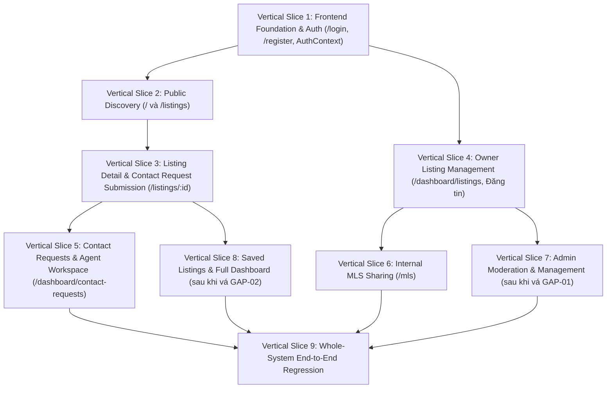

# BÁO CÁO KIỂM TOÁN SẴN SÀNG TÍCH HỢP FRONTEND & BACKEND (PHASE 2E-0)
**Thời gian lập báo cáo:** 2026-11-02
**Mã dự án:** Batdongsan
**Nhánh Git:** `feat/phase2d2-contact-requests`
**Base commit:** `9b9c61c` (*"feat(phase2d2): implement contact requests and agent assignments"*)
**Công nghệ:** Next.js 16.4.2 (React 19, Tailwind CSS 4), NestJS 12, PostgreSQL 16 Native Windows, Prisma 7.10.1
**Tác giả:** Senior Fullstack Architect / AI Engineering Pair

---

## 1. Tóm tắt điều hành (Executive Summary)

Đợt kiểm toán này được thực hiện theo chế độ **Chỉ đọc (Read-only)** nhằm thẩm định toàn diện tính sẵn sàng tích hợp giữa giao diện người dùng (Frontend Next.js 16) và hệ thống dịch vụ dữ liệu (Backend NestJS 12), kết nối trực tiếp với **14 màn hình thiết kế máy tính (Desktop) bằng tiếng Việt** đã hoàn thành trên Google Stitch (Project ID: `13967597418813716400`).

### Các phát hiện cốt lõi:
1. **Hiện trạng Backend (Phase 2A -> 2D-2 hoàn thành xuất sắc):**
   - Đã cam kết (committed) và đẩy lên remote (`origin`) an toàn tại commit `9b9c61c`.
   - Toàn bộ 5 module nghiệp vụ cốt lõi đã có đầy đủ logic, phân quyền (RBAC), chống ghi đè đồng thời (concurrency conditional updates), và bảo mật thông tin nhạy cảm: `AuthModule`, `ListingsModule`, `MlsModule`, `ContactRequestsModule`, `PrismaModule`.
   - Bộ kiểm thử backend đạt độ tin cậy tuyệt đối: **132/132 unit tests passed**, **88/88 real PostgreSQL E2E tests passed**, lint đạt 0 lỗi/cảnh báo, build thành công, database fingerprint giữ nguyên vẹn.
2. **Hiện trạng Thiết kế Stitch (14/14 màn hình Desktop sẵn sàng):**
   - Đã kiểm kê và xác thực trực tiếp qua Stitch MCP: 14 màn hình giao diện Desktop tiếng Việt đầy đủ mã HTML/CSS và tuân thủ chặt chẽ Design System Version 2 (`#0F766E` Deep Teal, `#142B4A` Deep Navy, `#F8FAFC` Slate-50, font `Be Vietnam Pro`, bo góc 8px).
   - Tuyệt đối bảo tồn các thiết kế Stitch này, không thiết kế lại hay thay đổi phong cách visual.
3. **Hiện trạng Frontend Next.js (Mới dừng ở mức Scaffold khởi tạo):**
   - Frontend mới chỉ có cấu hình cơ bản của Next.js 16 (App Router), Tailwind CSS 4, font Be Vietnam Pro tại [frontend/src/app/layout.tsx](file:///D:/Batdongsan/frontend/src/app/layout.tsx) và trang giữ chỗ tối giản tại [frontend/src/app/page.tsx](file:///D:/Batdongsan/frontend/src/app/page.tsx).
   - **Chưa có bất kỳ trang nghiệp vụ nào** (`/login`, `/register`, `/listings`, `/dashboard`, v.v.).
   - **Chưa có API client tập trung**, chưa có cơ chế lưu trữ JWT và quản lý phiên đăng nhập (`AuthContext`), chưa có layout phân quyền (`Role-aware layout`), chưa có schema kiểm thực form, và chưa có bộ kiểm thử tự động frontend.
4. **Phát hiện 5 khoảng trống Backend (Backend Gaps) đối với 14 màn hình Stitch:**
   - **Gap 1 (Admin Listing Moderation List):** Thiếu endpoint cho ADMIN truy vấn danh sách toàn bộ tin đang chờ duyệt `GET /api/admin/listings?status=PENDING` (chặn màn hình 13 `ec689ce7` "Quản trị - Duyệt tin đăng"). Hiện tại `GET /api/listings` chỉ trả về `APPROVED`, còn `GET /api/listings/mine` chỉ lọc theo `ownerId`.
   - **Gap 2 (Saved Listings):** Thiếu toàn bộ các endpoint CRUD cho tính năng lưu tin yêu thích (`GET /api/listings/saved`, `POST /api/listings/:id/save`, `DELETE /api/listings/:id/save`) dù model Prisma `SavedListing` đã tồn tại trong database (chặn màn hình 10 `2f92bd0da4fe` "Bất động sản đã lưu").
   - **Gap 3 (Forgot / Reset Password):** Thiếu API `POST /api/auth/forgot-password` và `POST /api/auth/reset-password` (chặn màn hình 6 `198bb4e3` "Quên mật khẩu").
   - **Gap 4 (User Profile & Password Update):** Thiếu API `PATCH /api/users/profile` và `PATCH /api/users/change-password` (chặn chức năng chỉnh sửa tại màn hình 12 `b8850605` "Thông tin tài khoản").
   - **Gap 5 (Binary Image Upload):** Thiếu API tiếp nhận upload tệp ảnh trực tiếp (`multipart/form-data`) cho tin đăng và ảnh đại diện; hiện tại backend chỉ nhận mảng URL chuỗi (`images: [{ url, order }]`).
5. **Chiến lược Tích hợp Khuyến nghị:**
   - Tuyệt đối **không** xây dựng toàn bộ frontend rồi mới kết nối backend ở cuối.
   - Tiến hành tích hợp theo từng **Vertical Slice (Lát cắt nghiệp vụ dọc)** độc lập, kiểm thử E2E khép kín từ UI đến Database cho từng luồng trước khi chuyển sang luồng tiếp theo.
   - **Lát cắt cần thực hiện ĐẦU TIÊN:** **Vertical Slice 1 — Frontend Foundation, Centralized API Client & Authentication Lifecycle (`/login`, `/register`, AuthContext, User Profile)**.

---

## 2. Hiện trạng Git và Cấu trúc Kho lưu trữ (Actual Repository and Git State)

### 2.1. Thông số Git
- **Project Root:** `D:\Batdongsan`
- **Nhánh hiện tại:** `feat/phase2d2-contact-requests`
- **Commit HEAD:** `9b9c61c` (*"feat(phase2d2): implement contact requests and agent assignments"*)
- **Remote Tracking:** Trùng khớp hoàn toàn với `origin/feat/phase2d2-contact-requests`
- **Working Tree:** Sạch (Clean), bảo tồn nguyên vẹn 2 tệp nội bộ:
  - `backend/check-db-fingerprint.mjs`
  - `phase2d2-review.patch`
- **Lịch sử nhánh:**
  - `3cbdd69`: Initial project setup
  - `ff1b327`: Phase 1 scaffold
  - `a0aa62a`: Phase 2A database foundation & seed
  - `bf9d6eb`: Phase 2B auth & Phase 2C listings
  - `72e5d92`: Phase 2B supplemental E2E tests
  - `0a355a7`: Phase 2D-1 internal MLS
  - `9b9c61c`: Phase 2D-2 contact requests & agent assignments

### 2.2. Cấu trúc thư mục mức cao
Dự án được bố trí theo cấu trúc tách biệt Frontend / Backend:
```
D:\Batdongsan\
├── backend/            # NestJS 12 backend application
├── frontend/           # Next.js 16 frontend application
├── database/           # Prisma schema, migrations, seed script
├── design/             # Thư mục chứa tài nguyên thiết kế cục bộ (hiện đang rỗng)
├── assets/             # Thư mục media mẫu
├── docs/               # Tài liệu yêu cầu (01-requirements.md) và các báo cáo
│   └── reports/        # Báo cáo tiến độ và kiểm toán các pha
├── tests/              # Thư mục kiểm thử mức hệ thống (hiện đang rỗng)
└── phase2d2-review.patch
```
*Lưu ý:* Dự án không sử dụng công cụ monorepo (Lerna, Turborepo hay npm workspaces). `frontend` và `backend` là hai dự án Node.js độc lập có `package.json` và `node_modules` riêng.

---

## 3. Kiểm kê Kiến trúc Frontend (Frontend Architecture Inventory)

- **Framework:** Next.js 16.4.2 (App Router).
- **Thư viện UI:** React 19.3.0, React DOM 19.3.0.
- **Styling:** Tailwind CSS 4.3.3 kết hợp `@tailwindcss/postcss`.
- **Cấu hình font:** Font chữ chuẩn tiếng Việt `Be Vietnam Pro` (weights: 400, 500, 600, 700) cấu hình qua `next/font/google` trong [layout.tsx](file:///D:/Batdongsan/frontend/src/app/layout.tsx).
- **CSS Tokens & Design System:** Tệp [globals.css](file:///D:/Batdongsan/frontend/src/app/globals.css) đã khai báo các biến CSS token tương ứng với Stitch Design System:
  - `--color-primary: #0F766E` (Deep Teal)
  - `--color-primary-600: #0D6660`
  - `--color-primary-700: #0A524D`
  - `--color-navy: #142B4A` (Deep Navy)
  - `--color-background: #F8FAFC` (Slate-50)
  - `--color-surface: #FFFFFF`
  - `--color-border: #E2E8F0`
  - `--color-muted: #475569`
  - `--radius: 8px`
- **Biến môi trường:** Tệp [frontend/.env.example](file:///D:/Batdongsan/frontend/.env.example) đã định nghĩa:
  ```env
  NEXT_PUBLIC_API_BASE_URL=http://localhost:3001
  PORT=3000
  ```
- **Các thành phần còn thiếu trong Frontend:**
  1. *API Client:* Chưa có tệp fetch client hoặc axios wrapper tập trung nào trong `frontend/src`.
  2. *Authentication State:* Chưa có `AuthContext` hay store lưu trữ JWT / profile người dùng.
  3. *Route Guards / Layouts:* Chưa có cơ chế bảo vệ route cho các vai trò (`BUYER`, `OWNER`, `AGENT`, `ADMIN`).
  4. *Form & Validation:* Chưa tích hợp thư viện quản lý form (React Hook Form) hay validation schema (Zod) khớp với DTO backend.
  5. *Test Suite:* `frontend/package.json` hoàn toàn chưa có script kiểm thử (`jest`, `vitest`, `playwright` chưa được cài đặt).

---

## 4. Kiểm kê 14 Màn hình Stitch (Stitch Screen Inventory)

Truy vấn trực tiếp qua công cụ Stitch MCP trên dự án **Batdongsan** (Project ID: `13967597418813716400`):

| # | Tên màn hình Stitch chính thức | Screen ID | Kích thước Viewport | Vai trò người dùng | Đường dẫn Next.js dự kiến | Tình trạng mã nguồn Stitch |
|---|---|---|---|---|---|---|
| **01** | **Trang chủ Batdongsan (Desktop)** | `b9d3227abd6248c59bcf0080b813e73f` | 2560 × 5606 | Public / Mọi vai trò | `/` | Đầy đủ HTML/CSS |
| **02** | **Kết quả tìm kiếm bất động sản (Desktop)** | `a79d19efca5d499283ae8203dc185963` | 2560 × 3316 | Public / Mọi vai trò | `/listings` | Đầy đủ HTML/CSS |
| **03** | **Chi tiết bất động sản (Desktop)** | `ed439158f49c45a9a33d31e014de8d2a` | 2560 × 6644 | Public / Buyer | `/listings/[id]` | Đầy đủ HTML/CSS |
| **04** | **Đăng nhập Batdongsan (Desktop)** | `172be7f0326346cc93a182fd06abc7d7` | 2560 × 2048 | Khách chưa đăng nhập | `/login` | Đầy đủ HTML/CSS |
| **05** | **Đăng ký tài khoản Batdongsan (Desktop)** | `afd1e0bfcea14563ab2e8243a927318b` | 2560 × 2374 | Khách chưa đăng nhập | `/register` | Đầy đủ HTML/CSS |
| **06** | **Quên mật khẩu Batdongsan (Desktop)** | `198bb4e3cfaa45109b2634275adad85a` | 2560 × 2048 | Khách chưa đăng nhập | `/forgot-password` | Đầy đủ HTML/CSS |
| **07** | **Dashboard người dùng Batdongsan (Desktop)** | `2df0cf616ac641fa800c7492edbd985f` | 2560 × 2048 | Authenticated (Tất cả) | `/dashboard` | Đầy đủ HTML/CSS |
| **08** | **Quản lý tin đăng Batdongsan (Desktop)** | `b9c95a83be0f4793ad068441dc854db9` | 2560 × 2670 | Owner, Agent, Admin | `/dashboard/listings` | Đầy đủ HTML/CSS |
| **09** | **Đăng tin bất động sản Batdongsan (Desktop)** | `39bf069378184dd089e1f72f64830538` | 2560 × 4602 | Owner, Agent | `/listings/create` | Đầy đủ HTML/CSS |
| **10** | **Bất động sản đã lưu Batdongsan (Desktop)** | `2f92bd0da4fe41b493db03e66acbf413` | 2560 × 2508 | Buyer / Authenticated | `/dashboard/saved` | Đầy đủ HTML/CSS |
| **11** | **Yêu cầu liên hệ Batdongsan (Desktop)** | `ba25bc79c3714cd1b36ba50d4968b30f` | 2560 × 3484 | Buyer, Owner, Agent, Admin | `/dashboard/contact-requests` | Đầy đủ HTML/CSS |
| **12** | **Thông tin tài khoản Batdongsan (Desktop)** | `b885060516de4e848affa8f28d6a424a` | 2560 × 2912 | Authenticated (Tất cả) | `/profile` | Đầy đủ HTML/CSS |
| **13** | **Quản trị - Duyệt tin đăng Batdongsan (Desktop)** | `ec689ce7903b4361803caaa95086c250` | 2560 × 2048 | Admin | `/admin/moderation` | Đầy đủ HTML/CSS |
| **14** | **Quản trị - MLS nội bộ Batdongsan (Desktop)** | `130cfd02c077494baeff3d547ead3256` | 2560 × 3790 | Owner, Agent, Admin | `/mls` | Đầy đủ HTML/CSS |

*Các tài nguyên phụ trợ khác trong Stitch Project (không phải màn hình nghiệp vụ chính):*
- Screen `9e76163e`: Bản sao chép trùng lặp của màn hình Đăng nhập (loại trừ, chỉ dùng `172be7f0`).
- Screen `086dd8c5`: Bản nháp chưa gắn nhãn hoàn chỉnh của màn hình Quản lý tin đăng (loại trừ, dùng `b9c95a83`).
- Screen `10e15229`: Bản prototype tiếng Anh cũ ban đầu (loại trừ).
- Các ảnh render nội thất/kiến trúc: `c77157e8`, `ae14cc14`, `2ca55744`, `302440c1` (dùng làm ảnh minh họa mẫu).

---

## 5. Kiểm kê Hợp đồng API Backend Thực tế (Backend API Contract Inventory)

Toàn bộ các endpoint HTTP thực tế đã được kiểm tra trực tiếp trong mã nguồn NestJS Controllers:

### A. Phân hệ Xác thực & Người dùng (Authentication)
Controller: [backend/src/auth/auth.controller.ts](file:///D:/Batdongsan/backend/src/auth/auth.controller.ts) (Prefix: `/api/auth`)

| Phương thức | Đường dẫn API | Vai trò | DTO đầu vào | Cấu trúc dữ liệu trả về | Trạng thái triển khai |
|---|---|---|---|---|:---:|
| `POST` | `/api/auth/register` | Public | `RegisterDto` (`email`, `password`, `fullName`, `registrationIntent?`) | `{ id, email, fullName, role: 'BUYER', registrationIntent, createdAt }` | **ĐÃ HOÀN THÀNH** |
| `POST` | `/api/auth/login` | Public | `LoginDto` (`email`, `password`) | `{ accessToken, user: { id, email, fullName, role } }` | **ĐÃ HOÀN THÀNH** |
| `GET` | `/api/auth/me` | Bearer JWT | Không có | `{ id, email, fullName, role, phone, avatarUrl, registrationIntent, isActive, createdAt }` | **ĐÃ HOÀN THÀNH** |
| `POST` | `/api/auth/forgot-password` | Public | N/A | N/A | **CHƯA CÓ (GAP)** |
| `PATCH` | `/api/users/profile` | Bearer JWT | N/A | N/A | **CHƯA CÓ (GAP)** |

### B. Phân hệ Tin đăng & Kiểm duyệt (Listings & Moderation)
Controller: [backend/src/listings/listings.controller.ts](file:///D:/Batdongsan/backend/src/listings/listings.controller.ts) (Prefix: `/api/listings`)

| Phương thức | Đường dẫn API | Vai trò | DTO đầu vào | Cấu trúc dữ liệu trả về | Trạng thái triển khai |
|---|---|---|---|---|:---:|
| `POST` | `/api/listings` | OWNER, AGENT | `CreateListingDto` (tiêu đề, giá, loại BĐS, hình thức giao dịch, địa chỉ, ảnh, v.v.) | Listing object (DRAFT status, priceVnd dạng string) | **ĐÃ HOÀN THÀNH** |
| `GET` | `/api/listings/mine` | Authenticated | `QueryMyListingsDto` (`status?`, `page?`, `limit?`) | `{ data: Listing[], meta: { total, page, limit, totalPages } }` | **ĐÃ HOÀN THÀNH** |
| `GET` | `/api/listings` | Public | `QueryListingsDto` (bộ lọc đa tiêu chí, phân trang) | `{ data: PublicListing[], meta: { total, page, limit, totalPages } }` (chỉ trả về APPROVED, ẩn địa chỉ chi tiết/tọa độ) | **ĐÃ HOÀN THÀNH** |
| `GET` | `/api/listings/:id` | Public | Không có | PublicListing object (chỉ APPROVED; 404 nếu status khác) | **ĐÃ HOÀN THÀNH** |
| `PATCH` | `/api/listings/:id` | Owner, ADMIN | `UpdateListingDto` | Listing object cập nhật (chỉ áp dụng cho DRAFT/REJECTED) | **ĐÃ HOÀN THÀNH** |
| `POST` | `/api/listings/:id/submit` | Listing Owner | Không có | `{ id, status: 'PENDING', message }` | **ĐÃ HOÀN THÀNH** |
| `POST` | `/api/listings/:id/moderate` | ADMIN | `ModerateListingDto` (`status`: APPROVED/REJECTED, `reason?`) | `{ id, status, moderationLog }` | **ĐÃ HOÀN THÀNH** |
| `GET` | `/api/listings/:id/moderation-history` | ADMIN | Không có | `ModerationLog[]` kèm thông tin Admin duyệt | **ĐÃ HOÀN THÀNH** |
| `GET` | `/api/admin/listings` (pending) | ADMIN | N/A | N/A | **CHƯA CÓ (GAP)** |
| `POST/DELETE` | `/api/listings/:id/save` | Authenticated | N/A | N/A | **CHƯA CÓ (GAP)** |
| `GET` | `/api/listings/saved` | Authenticated | N/A | N/A | **CHƯA CÓ (GAP)** |

### C. Phân hệ Mạng lưới MLS Nội bộ (Internal MLS)
Controller: [backend/src/mls/mls.controller.ts](file:///D:/Batdongsan/backend/src/mls/mls.controller.ts) (Prefix: `/api/mls`)

| Phương thức | Đường dẫn API | Vai trò | DTO đầu vào | Cấu trúc dữ liệu trả về | Trạng thái triển khai |
|---|---|---|---|---|:---:|
| `POST` | `/api/mls/shares` | Listing Owner | `GrantMlsShareDto` (`listingId`, `receivedById`, `permission`, `expiresAt?`) | MlsShare object (`isActive: true`) | **ĐÃ HOÀN THÀNH** |
| `POST/DELETE` | `/api/mls/shares/:id/revoke` | Owner, ADMIN | `RevokeMlsShareDto` (`reason?`) | MlsShare object (`isActive: false`, `revokedAt`) | **ĐÃ HOÀN THÀNH** |
| `GET` | `/api/mls/shares/received` | AGENT | `QueryReceivedMlsSharesDto` (`page?`, `limit?`) | `{ data: ReceivedShare[], meta: { total, page, limit, totalPages } }` | **ĐÃ HOÀN THÀNH** |
| `GET` | `/api/mls/listings/:listingId/shares` | Owner, ADMIN | `QueryMlsShareHistoryDto` (`page?`, `limit?`) | `{ data: MlsShare[], meta: { total, page, limit, totalPages } }` | **ĐÃ HOÀN THÀNH** |
| `GET` | `/api/mls/listings/:id` | Owner, ADMIN, AGENT được chia sẻ | Không có | SharedListingDetail (chi tiết nhạy cảm theo phân quyền VIEW vs MANAGE) | **ĐÃ HOÀN THÀNH** |

### D. Phân hệ Yêu cầu Tư vấn & Phân bổ Môi giới (Contact Requests & Assignments)
Controller: [backend/src/contact-requests/contact-requests.controller.ts](file:///D:/Batdongsan/backend/src/contact-requests/contact-requests.controller.ts) (Prefix: `/api/contact-requests`)

| Phương thức | Đường dẫn API | Vai trò | DTO đầu vào | Cấu trúc dữ liệu trả về | Trạng thái triển khai |
|---|---|---|---|---|:---:|
| `POST` | `/api/contact-requests` | BUYER, OWNER, AGENT | `CreateContactRequestDto` (`listingId`, `message?`, `contactConsent: true`) | Request object kèm thông tin auto-assign nếu có | **ĐÃ HOÀN THÀNH** |
| `GET` | `/api/contact-requests/my-requests` | Buyer | `QueryContactRequestsDto` | `{ data: BuyerRequest[], meta }` | **ĐÃ HOÀN THÀNH** |
| `GET` | `/api/contact-requests/assigned` | AGENT | `QueryContactRequestsDto` | `{ data: AssignedRequest[], meta }` (ẩn SĐT/email nếu `contactConsent=false`) | **ĐÃ HOÀN THÀNH** |
| `GET` | `/api/contact-requests/for-owned-listings` | OWNER, AGENT | `QueryContactRequestsDto` | `{ data: OwnedListingRequest[], meta }` (chỉ trả về metadata ẩn danh) | **ĐÃ HOÀN THÀNH** |
| `GET` | `/api/contact-requests` | ADMIN | `QueryContactRequestsDto` (`status?`, `agentId?`, `unassigned?`, `page?`, `limit?`) | `{ data: AdminRequestOverview[], meta }` | **ĐÃ HOÀN THÀNH** |
| `GET` | `/api/contact-requests/:id` | Người liên quan / ADMIN | Không có | RequestDetail tailored theo quyền của Caller | **ĐÃ HOÀN THÀNH** |
| `PATCH` | `/api/contact-requests/:id/status` | Assigned Agent, ADMIN | `UpdateRequestStatusDto` (`status`) | `{ id, status, updatedAt }` | **ĐÃ HOÀN THÀNH** |
| `POST` | `/api/contact-requests/:id/assign` | ADMIN | `AssignAgentDto` (`agentId`) | Assignment result (optimistic conditional check) | **ĐÃ HOÀN THÀNH** |
| `POST` | `/api/contact-requests/:id/reassign` | ADMIN | `ReassignAgentDto` (`agentId`, `reason?`) | Reassignment result (lưu vết lịch sử) | **ĐÃ HOÀN THÀNH** |
| `POST` | `/api/contact-requests/:id/reopen` | ADMIN | `ReopenContactRequestDto` (`reason`) | Reopen result (chuyển đổi có điều kiện) | **ĐÃ HOÀN THÀNH** |
| `GET` | `/api/contact-requests/:id/assignments` | Assigned Agent, ADMIN | Không có | `AssignmentHistory[]` (sắp xếp thời gian) | **ĐÃ HOÀN THÀNH** |

### E. Quy ước Giao thức & Định dạng Dữ liệu (Conventions)
- **Prefix toàn cục:** Tất cả các endpoint đều có tiền tố `/api/` (khai báo trong [backend/src/main.ts:11](file:///D:/Batdongsan/backend/src/main.ts#L11)).
- **Cấu trúc Envelope danh sách:** Luôn đóng gói theo chuẩn `{ data: T[], meta: { total: number, page: number, limit: number, totalPages: number } }`.
- **Định dạng tiền tệ BigInt:** Toàn bộ trường `priceVnd` (BigInt trong database) được chuyển đổi thành `string` trong JSON response để tránh mất độ chính xác (precision loss) trên JavaScript frontend.
- **Tiêu đề xác thực:** `Authorization: Bearer <JWT_ACCESS_TOKEN>`.
- **Xử lý lỗi HTTP:**
  - Lỗi kiểm thực dữ liệu (400): Trả về `{ statusCode: 400, message: string[], error: 'Bad Request' }`.
  - Lỗi không có quyền (401/403): Trả về `{ statusCode: 401|403, message: string, error: 'Unauthorized'|'Forbidden' }`.
  - Lỗi xung đột đồng thời (409): Trả về `{ statusCode: 409, message: '... was modified concurrently. Please reload and retry.', error: 'Conflict' }`.

---

## 6. Ma trận Truy vết Frontend đến Backend (Traceability Matrix)

| # | Màn hình Stitch | Vai trò | Route Next.js | Các API Backend yêu cầu | Trạng thái API Backend | Đánh giá Sẵn sàng Tích hợp | Rào cản / Khoảng trống cần xử lý |
|---|---|---|---|---|:---:|---|---|
| **01** | **Trang chủ** (`b9d3227a`) | Public | `/` | `GET /api/listings` | **Có sẵn** | **READY WITH FRONTEND WORK** | Cần xây dựng component Header, SearchBar, CategoryCards, ListingGrid theo HTML Stitch. |
| **02** | **Kết quả tìm kiếm** (`a79d19ef`) | Public | `/listings` | `GET /api/listings` | **Có sẵn** | **READY WITH FRONTEND WORK** | Cần đồng bộ các query parameters trên URL (`?province=...&minPrice=...`) với backend query DTO. |
| **03** | **Chi tiết BĐS** (`ed439158`) | Public/Buyer | `/listings/[id]` | `GET /api/listings/:id`<br>`POST /api/contact-requests` | **Có sẵn** (cho xem & gửi tư vấn) | **READY WITH FRONTEND WORK** | Nút "Lưu tin" bị thiếu API `POST /api/listings/:id/save` (cần ẩn hoặc bổ sung API sau). |
| **04** | **Đăng nhập** (`172be7f0`) | Visitor | `/login` | `POST /api/auth/login` | **Có sẵn** | **READY WITH FRONTEND WORK** | Cần lưu JWT token vào storage và cập nhật AuthContext. |
| **05** | **Đăng ký** (`afd1e0bf`) | Visitor | `/register` | `POST /api/auth/register` | **Có sẵn** | **READY WITH FRONTEND WORK** | Cần lưu ý: Backend luôn tạo vai trò ban đầu là `BUYER`, vai trò hiển thị trên form là `registrationIntent`. |
| **06** | **Quên mật khẩu** (`198bb4e3`) | Visitor | `/forgot-password` | `POST /api/auth/forgot-password` | **CHƯA CÓ** | **BACKEND GAP** | Thiếu API quên/đặt lại mật khẩu. Cần triển khai endpoint ở backend hoặc tạm hoãn (P2). |
| **07** | **Dashboard** (`2df0cf61`) | Authenticated | `/dashboard` | `GET /api/auth/me`<br>`GET /api/listings/mine`<br>`GET /api/contact-requests/*` | **Một phần** (ghép từ các API con) | **READY WITH FRONTEND WORK** | Chưa có API tổng hợp thống kê `GET /api/dashboard/stats`, frontend có thể tổng hợp từ `meta.total` của các API danh sách. |
| **08** | **Quản lý tin đăng** (`b9c95a83`) | Owner, Agent, Admin | `/dashboard/listings` | `GET /api/listings/mine`<br>`POST /api/listings/:id/submit`<br>`PATCH /api/listings/:id` | **Có sẵn** | **READY WITH FRONTEND WORK** | Backend đã hỗ trợ đầy đủ bộ lọc theo status, nộp duyệt và sửa tin DRAFT/REJECTED. |
| **09** | **Đăng tin BĐS** (`39bf0693`) | Owner, Agent | `/listings/create` | `POST /api/listings` | **Có sẵn** (nhận URL ảnh) | **READY WITH FRONTEND WORK** | Backend hiện chưa có multipart upload; form sẽ nhập URL ảnh trực tiếp hoặc qua dịch vụ mock upload. |
| **10** | **BĐS đã lưu** (`2f92bd0d`) | Buyer | `/dashboard/saved` | `GET /api/listings/saved`<br>`DELETE /api/listings/:id/save` | **CHƯA CÓ** | **BACKEND GAP** | Model `SavedListing` đã có trong Prisma nhưng chưa có controller/service nào quản lý. Cần bổ sung API. |
| **11** | **Yêu cầu liên hệ** (`ba25bc79`) | Tất cả vai trò | `/dashboard/contact-requests` | `GET /api/contact-requests/*`<br>`PATCH /status`<br>`POST /assign`<br>`POST /reassign` | **Có sẵn 100%** | **READY WITH FRONTEND WORK** | Đã được kiểm thử concurrency và RBAC hoàn hảo ở Phase 2D-2. |
| **12** | **Thông tin tài khoản** (`b8850605`) | Authenticated | `/profile` | `GET /api/auth/me`<br>`PATCH /api/users/profile` | **Một phần** (chỉ có xem) | **READY WITH FRONTEND WORK** (cho xem) / **BACKEND GAP** (cho sửa) | Xem thông tin đã sẵn sàng; chức năng cập nhật họ tên/SĐT/đổi mật khẩu cần bổ sung endpoint backend. |
| **13** | **Quản trị duyệt tin** (`ec689ce7`) | Admin | `/admin/moderation` | `GET /api/admin/listings` (PENDING)<br>`POST /api/listings/:id/moderate`<br>`GET /:id/moderation-history` | **Một phần** (thiếu query PENDING) | **BACKEND GAP** | Thiếu API cho Admin liệt kê danh sách các tin đang ở trạng thái `PENDING` trên toàn hệ thống. |
| **14** | **Quản trị MLS nội bộ** (`130cfd02`) | Owner, Agent, Admin | `/mls` | `POST /api/mls/shares`<br>`POST /revoke`<br>`GET /received`<br>`GET /listings/:id` | **Có sẵn 100%** | **READY WITH FRONTEND WORK** | Đã hoàn thành và kiểm thử chặt chẽ quyền VIEW vs MANAGE ở Phase 2D-1. |

---

## 7. Đánh giá Tính Sẵn sàng Xác thực & Phân quyền (Authentication & Authorization Readiness)

1. **Cơ chế Token hiện tại:**
   - Backend sử dụng JWT Bearer token đơn lẻ (`accessToken`), được ký với thời hạn ngắn (cấu hình trong `JWT_SECRET`).
   - Token payload chứa: `{ sub: user.id, email: user.email, role: user.role, fullName: user.fullName }`.
   - **Chưa có Refresh Token / Rotation:** Khi token hết hạn, người dùng cần đăng nhập lại. Đây là thiết kế chấp nhận được cho giai đoạn đồ án/MVP, tránh phức tạp hóa cookie CSRF.
2. **Chiến lược Quản lý Phiên trên Frontend:**
   - Lưu trữ `accessToken` trong `localStorage` (hoặc `js-cookie` nếu cần Server-Side Rendering nhẹ).
   - Xây dựng `AuthProvider` cung cấp: `user`, `token`, `login(dto)`, `logout()`, `isAuthenticated`, `isLoading`.
   - Khi ứng dụng khởi động, nếu có token, tự động gọi `GET /api/auth/me` để đồng bộ thông tin hồ sơ mới nhất.
3. **Phân quyền Route (Route Protection & Layouts):**
   - **Nguyên tắc cốt lõi:** Frontend Route Guard chỉ phục vụ trải nghiệm người dùng (UX redirects: ví dụ ngăn Buyer bấm vào trang MLS của Agent). **Backend NestJS Guards (`JwtAuthGuard`, `RolesGuard`) là người gác cổng bảo mật tuyệt đối.**
   - Tạo các Layout phân quyền:
     - `PublicLayout`: Header công khai, thanh điều hướng chính, Footer (dành cho Trang chủ, Tìm kiếm, Chi tiết tin).
     - `AuthLayout`: Layout tối giản bo gọn ở giữa màn hình (dành cho Đăng nhập, Đăng ký, Quên mật khẩu).
     - `DashboardLayout`: Sidebar điều hướng bên trái + Header tài khoản trên cùng (dành cho Quản lý tin, MLS, Yêu cầu liên hệ, Hồ sơ, Duyệt tin Admin).

---

## 8. Đánh giá API Client & Tính An toàn Kiểu (API Client & Type-Safety Assessment)

### 8.1. Thiết kế API Client Tập trung (`frontend/src/lib/api-client.ts`)
- Sử dụng hàm `fetch` tích hợp sẵn của Next.js 16 / React 19 để tận dụng khả năng caching và streaming khi cần.
- **Tự động gắn Token:** Interceptor tự động thêm header `Authorization: Bearer ${token}` nếu người dùng đã đăng nhập.
- **Chuẩn hóa lỗi (Error Normalization):**
  ```typescript
  export interface ApiErrorResponse {
    statusCode: number;
    message: string | string[];
    error: string;
  }
  ```
  Tất cả các lỗi mạng, lỗi timeout, HTTP 400 (validation), 401, 403, 404, 409 (concurrency conflict) đều được chuẩn hóa thành một đối tượng `ApiClientError` nhất quán để các component UI dễ dàng hiển thị thông báo toast/alert.

### 8.2. Chia sẻ Kiểu Dữ liệu (Type Safety)
Vì không dùng monorepo workspace, frontend cần định nghĩa tệp `frontend/src/types/index.ts` ánh xạ 1-1 với Enums và DTO của backend:
- `Role`: `'BUYER' | 'OWNER' | 'AGENT' | 'ADMIN'`
- `ListingStatus`: `'DRAFT' | 'PENDING' | 'APPROVED' | 'REJECTED' | 'ARCHIVED'`
- `PropertyType`: `'APARTMENT' | 'HOUSE' | 'VILLA' | 'LAND' | 'COMMERCIAL' | 'OTHER'`
- `TransactionType`: `'FOR_SALE' | 'FOR_RENT'`
- `RentalPeriod`: `'MONTH' | 'QUARTER' | 'YEAR'`
- `ContactRequestStatus`: `'NEW' | 'IN_PROGRESS' | 'COMPLETED' | 'REJECTED'`
- `MlsSharePermission`: `'VIEW' | 'MANAGE'`
- `RegistrationIntent`: `'BUYER' | 'OWNER' | 'AGENT'`

---

## 9. Chiến lược Tái sử dụng Thiết kế Stitch (Design System Reuse Strategy)

Để đảm bảo giữ nguyên 100% bản sắc visual từ 14 màn hình Stitch mà không làm phân mảnh mã nguồn, áp dụng quy trình chuyển đổi thành phần (Component Extraction):
1. **Trích xuất Layout dùng chung:**
   - `Navbar`: Thanh điều hướng đầu trang kèm logo Batdongsan, menu tìm kiếm, nút Đăng tin, avatar/nút đăng nhập.
   - `Footer`: Chân trang 4 cột chuyên nghiệp giới thiệu dịch vụ và chính sách.
   - `Sidebar`: Menu thanh bên dùng cho Dashboard và Admin, đổi mục tùy theo vai trò `user.role`.
2. **Trích xuất UI Components dùng chung:**
   - `Button`: Biến thể `primary` (`bg-[#0F766E] text-white hover:bg-[#0D6660]`), `secondary` (`border-[#E2E8F0] bg-white text-[#142B4A]`), `danger` (`bg-rose-600 text-white`).
   - `Input` & `Select`: Viền mảnh `#E2E8F0`, bo góc 8px, padding 10px 14px, focus ring `#0F766E`.
   - `PropertyCard`: Thẻ bất động sản chuẩn tỉ lệ ảnh 16:9, giá tiền tỷ/triệu, thông số phòng ngủ/diện tích, badge trạng thái / MLS.
   - `StatusBadge`:
     - `APPROVED` / `COMPLETED`: `bg-emerald-50 text-emerald-700 border-emerald-200`
     - `PENDING` / `IN_PROGRESS`: `bg-amber-50 text-amber-700 border-amber-200`
     - `REJECTED`: `bg-rose-50 text-rose-700 border-rose-200`
     - `DRAFT` / `NEW`: `bg-slate-100 text-slate-700 border-slate-200`

---

## 10. Khoảng trống Backend Chi tiết (Missing Backend APIs & Capabilities)

| Mã Gap | Mô tả khoảng trống | Tác động đến màn hình Stitch | Đề xuất kỹ thuật khắc phục |
|---|---|---|---|
| **GAP-01** | **Thiếu API truy vấn tin chờ duyệt cho Admin:** Chưa có endpoint liệt kê tin đăng ở trạng thái `PENDING` trên phạm vi toàn hệ thống. | Chặn hoàn toàn màn hình 13 (`ec689ce7` - Duyệt tin đăng). Admin không thể xem danh sách tin cần duyệt. | Bổ sung phương thức `getPendingListings(query)` tại `ListingsController` với route `GET /api/listings/pending` hoặc `GET /api/admin/listings?status=PENDING` được bảo vệ bởi `@Roles(Role.ADMIN)`. |
| **GAP-02** | **Thiếu Module Tin đăng đã lưu (Saved Listings):** Model `SavedListing` đã có trong Prisma nhưng chưa có controller/service nào xử lý. | Chặn hoàn toàn màn hình 10 (`2f92bd0d` - Bất động sản đã lưu) và nút bấm yêu thích trên trang chi tiết tin. | Tạo `SavedListingsModule` hoặc tích hợp vào `ListingsController`: `POST /api/listings/:id/save`, `DELETE /api/listings/:id/save`, `GET /api/listings/saved`. |
| **GAP-03** | **Thiếu API Quên/Đặt lại mật khẩu:** Chưa có logic gửi email và token đặt lại mật khẩu. | Chặn màn hình 06 (`198bb4e3` - Quên mật khẩu). | Triển khai mock hoặc endpoint trả về thành công trong môi trường phát triển: `POST /api/auth/forgot-password`. |
| **GAP-04** | **Thiếu API Cập nhật Hồ sơ cá nhân & Đổi mật khẩu:** `AuthController` chỉ có `GET /api/auth/me`. | Chặn tính năng lưu thay đổi thông tin cá nhân trên màn hình 12 (`b8850605`). | Bổ sung endpoint `PATCH /api/auth/profile` (cập nhật họ tên, SĐT) và `POST /api/auth/change-password` trong `AuthModule`. |
| **GAP-05** | **Thiếu API Upload tệp ảnh trực tiếp:** Chưa có xử lý upload tệp đa phương tiện `multipart/form-data`. | Màn hình 09 (`39bf0693` - Đăng tin) và avatar người dùng hiện phải dùng URL chuỗi thay vì chọn file từ máy. | Giai đoạn đầu chấp nhận nhập URL ảnh trực tiếp từ Unsplash/Pexels hoặc tạo mock upload cục bộ lưu vào thư mục `public/uploads`. |

---

## 11. Xếp hạng Rào cản Tích hợp (Ranked Integration Blockers)

### Mức P0 — Rào cản Chặn toàn bộ Tích hợp (Blocker):
- **Chưa có API Client & AuthContext trên Frontend:** Không thể kết nối bất kỳ màn hình nào với backend nếu chưa có client HTTP chuẩn hóa và bộ lưu trữ token JWT.

### Mức P1 — Rào cản Chặn các Lát cắt Nghiệp vụ Cụ thể (High Priority):
- **GAP-01 (Admin Pending Listings):** Chặn luồng nghiệp vụ kiểm duyệt tin của Quản trị viên (Màn hình 13). Cần xử lý trước khi thực hiện slice Quản trị duyệt tin.
- **GAP-02 (Saved Listings API):** Chặn trải nghiệm lưu tin của Người mua (Màn hình 10). Cần xử lý trước khi thực hiện slice Tin đã lưu.

### Mức P2 — Có thể Hoãn lại hoặc Dùng giải pháp thay thế (Medium/Low Priority):
- **GAP-03 (Forgot Password):** Có thể giữ giao diện tĩnh thông báo tính năng demo trong đồ án.
- **GAP-04 (Edit Profile):** Có thể hiển thị thông tin ở chế độ chỉ đọc (Read-only) trong bước đầu.
- **GAP-05 (Multipart File Upload):** Dùng cơ chế nhập URL ảnh mẫu hoặc mock local image picker.

---

## 12. Thứ tự Thực hiện Đề xuất theo Lát cắt Dọc (Vertical-Slice Implementation Order)

Áp dụng nghiêm ngặt nguyên tắc: **Hoàn thiện, tích hợp và kiểm thử khép kín từng luồng nghiệp vụ trước khi chuyển sang luồng tiếp theo.**



### Chi tiết 8 Lát cắt nghiệp vụ:
1. **Vertical Slice 1 — Nền tảng Frontend, API Client & Vòng đời Xác thực:**
   - *Màn hình:* Đăng nhập (`172be7f0`), Đăng ký (`afd1e0bf`).
   - *Backend APIs:* `POST /api/auth/register`, `POST /api/auth/login`, `GET /api/auth/me`.
   - *Mục tiêu:* Thiết lập `api-client.ts`, `AuthProvider`, `types/index.ts`, Navbar, trang đăng nhập/đăng ký hoàn chỉnh có validate và lưu token.
2. **Vertical Slice 2 — Khám phá & Tìm kiếm Tin đăng Công khai:**
   - *Màn hình:* Trang chủ (`b9d3227a`), Kết quả tìm kiếm (`a79d19ef`).
   - *Backend APIs:* `GET /api/listings`.
   - *Mục tiêu:* Bộ lọc đa tiêu chí, thanh tìm kiếm nhanh, phân trang, lưới thẻ bất động sản chuẩn Stitch.
3. **Vertical Slice 3 — Chi tiết Bất động sản & Gửi Yêu cầu Tư vấn:**
   - *Màn hình:* Chi tiết BĐS (`ed439158`).
   - *Backend APIs:* `GET /api/listings/:id`, `POST /api/contact-requests`.
   - *Mục tiêu:* Xem ảnh, thông số, form gửi tư vấn tích hợp consent, kiểm tra ẩn thông tin nhạy cảm.
4. **Vertical Slice 4 — Quản lý & Đăng tin dành cho Chủ nhà/Môi giới:**
   - *Màn hình:* Quản lý tin đăng (`b9c95a83`), Đăng tin BĐS (`39bf0693`).
   - *Backend APIs:* `GET /api/listings/mine`, `POST /api/listings`, `POST /api/listings/:id/submit`, `PATCH /api/listings/:id`.
   - *Mục tiêu:* Form đăng tin đa bước, bảng quản lý tin cá nhân có lọc trạng thái, nộp duyệt tin.
5. **Vertical Slice 5 — Phân hệ Yêu cầu Tư vấn & Không gian Môi giới:**
   - *Màn hình:* Yêu cầu liên hệ (`ba25bc79`).
   - *Backend APIs:* Toàn bộ nhóm `GET /api/contact-requests/*`, `PATCH /:id/status`, các API gán của Admin.
   - *Mục tiêu:* Danh sách yêu cầu phân quyền theo Buyer/Agent/Owner/Admin, cập nhật tiến độ xử lý.
6. **Vertical Slice 6 — Mạng lưới Chia sẻ MLS Nội bộ:**
   - *Màn hình:* Quản trị MLS nội bộ (`130cfd02`).
   - *Backend APIs:* Toàn bộ nhóm `POST /api/mls/shares`, `POST /revoke`, `GET /received`, `GET /listings/:id`.
   - *Mục tiêu:* Chủ nhà cấp/hủy quyền chia sẻ tin, môi giới xem kho tin nhận được và xem thông tin bảo mật theo quyền VIEW/MANAGE.
7. **Vertical Slice 7 — Kiểm duyệt Tin & Quản trị Hệ thống:**
   - *Màn hình:* Quản trị duyệt tin đăng (`ec689ce7`).
   - *Backend APIs:* Vá **GAP-01** bổ sung `GET /api/admin/listings?status=PENDING`, kết nối `POST /api/listings/:id/moderate`, `GET /:id/moderation-history`.
   - *Mục tiêu:* Admin xem danh sách tin chờ duyệt, duyệt hoặc từ chối kèm lý do bắt buộc, xem lịch sử kiểm duyệt.
8. **Vertical Slice 8 — Bất động sản đã lưu & Dashboard Tổng quan:**
   - *Màn hình:* Bất động sản đã lưu (`2f92bd0d`), Dashboard người dùng (`2df0cf61`), Thông tin tài khoản (`b8850605`).
   - *Backend APIs:* Vá **GAP-02** bổ sung API SavedListings, ghép số liệu tổng quan vào Dashboard.
   - *Mục tiêu:* Hoàn thiện trải nghiệm cá nhân hóa cho người dùng.

---

## 13. Tiêu chí Nghiệm thu Chi tiết cho Từng Lát cắt

### Lát cắt 1 (Foundation & Auth):
- [ ] Người dùng truy cập `/register`, nhập thông tin hợp lệ -> Tạo tài khoản thành công, thông báo chuyển hướng sang Đăng nhập.
- [ ] Nhập email đã tồn tại -> Nhận thông báo lỗi 409 rõ ràng bằng tiếng Việt.
- [ ] Người dùng truy cập `/login`, nhập sai mật khẩu -> Hiển thị thông báo "Email hoặc mật khẩu không chính xác".
- [ ] Đăng nhập đúng -> Nhận JWT, lưu vào storage, chuyển hướng về Dashboard/Trang chủ, Navbar cập nhật tên và avatar người dùng.
- [ ] F5 (Reload trang) -> Phiên đăng nhập được duy trì mượt mà, không bị logout bất ngờ.

### Lát cắt 2 (Public Search):
- [ ] Trang chủ `/` tải dữ liệu tin mới nhất từ `GET /api/listings?limit=6`.
- [ ] Bấm lọc "Hà Nội", "Căn hộ", "Bán" trên SearchBar -> Chuyển sang `/listings?province=Hà+Nội&propertyType=APARTMENT&transactionType=FOR_SALE`.
- [ ] Trang kết quả tìm kiếm hiển thị danh sách thẻ tin tương ứng, có phân trang chính xác.
- [ ] Không có bất kỳ thẻ tin nào để lộ số nhà cụ thể hay tọa độ GPS (bảo vệ quyền riêng tư).

### Lát cắt 3 (Listing Detail & Contact Request):
- [ ] Truy cập `/listings/:id` với tin đã duyệt (APPROVED) -> Hiển thị đầy đủ ảnh, giá, mô tả.
- [ ] Truy cập với ID tin chưa duyệt (PENDING/DRAFT) -> Hiển thị trang 404 Not Found.
- [ ] Form tư vấn: Người mua chưa đăng nhập bấm gửi -> Yêu cầu đăng nhập.
- [ ] Người mua đã đăng nhập tích chọn "Đồng ý chia sẻ thông tin liên hệ" và gửi -> Tạo yêu cầu thành công, hệ thống tự động gán môi giới nếu đủ điều kiện.

---

## 14. Phân tích Rủi ro & Quyết định Kỹ thuật

1. **Rủi ro Đồng bộ Kiểu Dữ liệu giữa 2 thư mục độc lập:**
   - *Quyết định:* Tạo tệp kiểu nguồn chuẩn `frontend/src/types/index.ts` đối soát thủ công với Prisma schema và DTO backend. Không áp dụng OpenAPI code generator phức tạp để tránh phụ thuộc cấu hình build.
2. **Quyết định về Token Storage:**
   - *Quyết định:* Lưu `accessToken` trong `localStorage` kết hợp đồng bộ vào `cookie` (`js-cookie`) để hỗ trợ Middleware Next.js kiểm tra phiên cơ bản mà không cần gọi API xác thực nặng nề tại Edge runtime.
3. **Quyết định về Xử lý Ảnh tin đăng:**
   - *Quyết định:* Để tránh phức tạp hóa hạ tầng lưu trữ S3/Cloudinary trong đồ án, cho phép nhập URL ảnh mẫu trong giai đoạn MVP và bổ sung tính năng chọn ảnh mẫu sẵn có từ thư mục `assets`.

---

## 15. Danh sách Tệp Nguồn đã Kiểm toán Trực tiếp

- **Backend:**
  - `backend/src/main.ts`
  - `backend/src/app.module.ts`
  - `backend/src/app.controller.ts`
  - `backend/src/auth/auth.controller.ts`
  - `backend/src/auth/auth.service.ts`
  - `backend/src/listings/listings.controller.ts`
  - `backend/src/listings/listings.service.ts`
  - `backend/src/mls/mls.controller.ts`
  - `backend/src/mls/mls.service.ts`
  - `backend/src/contact-requests/contact-requests.controller.ts`
  - `backend/src/contact-requests/contact-requests.service.ts`
  - `backend/test/contact-requests.e2e-spec.ts`
  - `backend/test/listings.e2e-spec.ts`
  - `backend/test/mls.e2e-spec.ts`
  - `database/prisma/schema.prisma`
- **Frontend:**
  - `frontend/package.json`
  - `frontend/src/app/layout.tsx`
  - `frontend/src/app/page.tsx`
  - `frontend/src/app/globals.css`
  - `frontend/.env.example`
- **Tài liệu & Báo cáo:**
  - `docs/01-requirements.md`
  - `docs/reports/PHASE_RECOVERY_AND_DESIGN_AUDIT_2026-10-21.md`
  - `docs/reports/PHASE2D2_TARGETED_REMEDIATION_2026-11-01.md`
- **Stitch MCP:**
  - Project `projects/13967597418813716400` ("Batdongsan")
  - Design Theme Version 2 (`assets/2311879688070030150`)
  - 14 Desktop Screen Instances

---

## 16. Khuyến nghị Tác vụ Tiếp theo (Final Recommendation)

### LÁT CẮT CẦN THỰC HIỆN ĐẦU TIÊN:
> **VERTICAL SLICE 1 — FRONTEND FOUNDATION, CENTRALIZED API CLIENT & AUTHENTICATION LIFECYCLE**
> **Các màn hình triển khai:** `172be7f0` (Đăng nhập) và `afd1e0bf` (Đăng ký)
> **Đường dẫn frontend:** `/login`, `/register`, `frontend/src/lib/api-client.ts`, `frontend/src/context/AuthContext.tsx`, `frontend/src/components/common/Navbar.tsx`

### Lý do xác đáng từ bằng chứng thực tế:
1. **Phụ thuộc tiên quyết của toàn bộ hệ thống:** Mọi luồng nghiệp vụ giá trị cao sau đó (Đăng tin của Chủ nhà, Không gian Môi giới xử lý yêu cầu, Chia sẻ MLS nội bộ, Kiểm duyệt của Admin) đều bắt buộc phải có phiên đăng nhập đã xác thực và phân quyền Role thông qua JWT Bearer token.
2. **Backend AuthModule đã sẵn sàng 100%:** Các endpoint `/api/auth/register`, `/api/auth/login`, `/api/auth/me` đã hoàn thành, kiểm thử chặt chẽ và không có bất kỳ khoảng trống kỹ thuật (Gap) nào.
3. **Thiết lập chuẩn mực kiến trúc cho toàn dự án:** Triển khai Vertical Slice 1 sẽ thiết lập ngay từ đầu các quy chuẩn dùng chung cốt lõi: hàm gọi API (`api-client.ts`), quản lý token an toàn, kiểu dữ liệu chia sẻ (`types/index.ts`), xử lý hiển thị lỗi HTTP, và Navbar điều hướng chuẩn Stitch.
